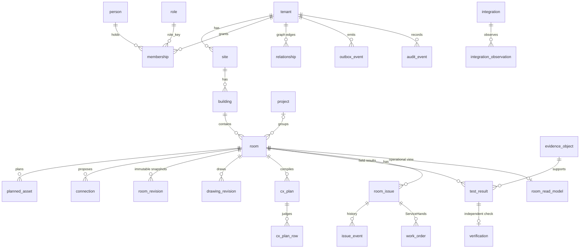
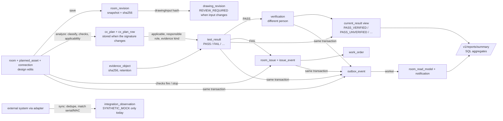
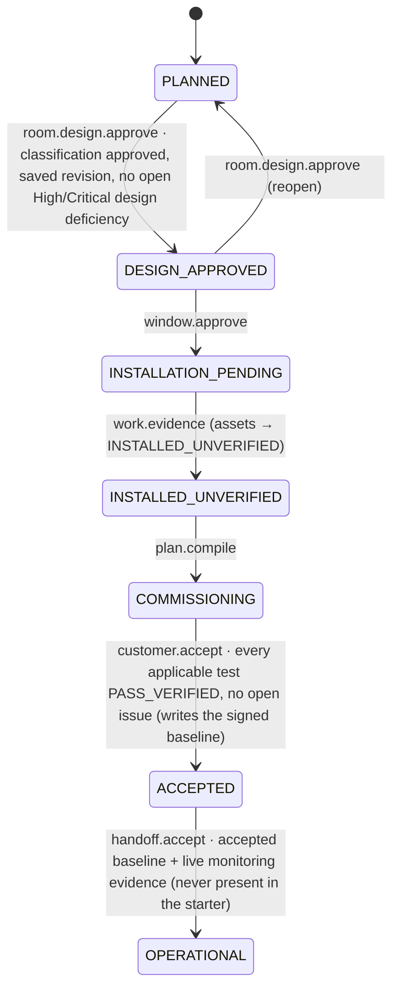
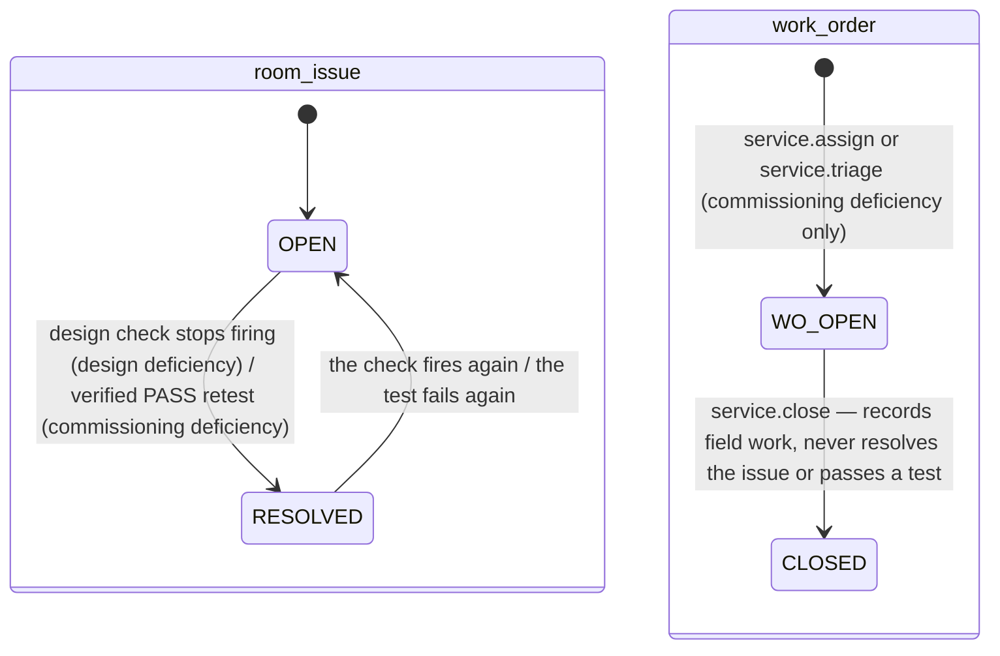

# Data architecture

The production starter keeps every piece of state in one PostgreSQL 16 database, schema `app` (business data) and `app_meta`
(migration ledger). This document explains how that data is shaped, who writes it, how tenants are kept apart, which state machines
govern it, and what is kept for how long. It describes the starter as built and tested on synthetic data; it is **not** a statement
that the schema is production-ready.

| Reference | What it is | How it is produced |
|---|---|---|
| [ENTITY_DICTIONARY.md](ENTITY_DICTIONARY.md) (+ `.json`) | every table and view: purpose, columns, checks, keys, RLS, policies, triggers, indexes | `node scripts/docs/entity-dictionary.mjs` (live catalog of a freshly migrated database) |
| [DATA_OWNERSHIP.md](DATA_OWNERSHIP.md) | which source module writes which table | `node scripts/docs/data-ownership.mjs` |
| [`database/schema/schema.sql`](../../database/schema/schema.sql) | the full schema as pg_dump prints it (reading copy) | `node scripts/docs/dump-schema.mjs` (`--check` fails when stale) |
| [`database/migrations/`](../../database/migrations/) | **the source of truth**: 0001–0008, forward-only | applied by `services/enterprise-api/src/db/migrate.ts` |
| [`packages/schemas/schemas/`](../../packages/schemas/) | JSON Schema 2020-12 for 101 events, 16 API request bodies, 4 entity shapes | `packages/schemas/scripts/generate.mjs` |
| [API guide](../api/API_GUIDE.md) | how the data is read and written over HTTP | — |

Counts at the time of writing (from the generators): **32 tables and 1 view**, 337 columns, 33 row-level-security policies,
11 triggers, 13 functions in schema `app`.

## 1. Canonical entities

Human-readable canonical codes come from `app.next_code(kind, prefix)` over the per-tenant `app.code_counter`: rooms `R-PLN-0001`,
planned assets `PA-0001`, connections `CN-0001`, issues `RISS-0001`, work orders `WO-0001`. A planned asset keeps its code when its model
is substituted (the model history is kept in `planned_asset.model_history`), so every product refers to the same device by the same id.

## 2. Data lineage

* Every write happens inside one request transaction with the tenant set (`set_config('app.tenant_id', …, true)`), and the domain events
  for it are appended to `outbox_event` **in the same transaction** — a change and its event commit or roll back together.
* The read model is rebuilt from the canonical tables, never patched incrementally (`readModelHandler` in
  `services/enterprise-api/src/worker/outbox.ts`), so a lost or repeated event cannot leave it wrong for long.
* Delivery (migration 0027): an aggregate's events are delivered strictly in `aggregate_seq` order — the order their transactions
  committed, numbered by the database at COMMIT (a deferred trigger takes the aggregates' `outbox_aggregate_head` rows in one sorted order,
  so concurrent emitters cannot deadlock on them); the producer's `aggregate_rev` is kept for consumers but never used for ordering, because
  several producers hard-code it. A later event is held while an
  earlier one is pending, retrying, leased or dead-lettered (until an audited replay; there is no skip); other aggregates flow in parallel.
  Each internal handler writes a receipt (`outbox_delivery`) in the same transaction as its effect (exactly once). External sinks
  (Teams/Outlook/connector events — none is configured in the starter) are called only after that transaction commits, with no
  transaction open, under a lease and with an idempotency key `outbox:<event id>:<sink>`: at-least-once, deduplicated by the consumer.
* Before any handler sees an event, the worker checks it against its contract (`@empathia/event-contracts`), its schema version, its
  tenant and the rooms it concerns; an event that fails is dead-lettered at once (`failure_kind = NON_RETRYABLE`, reason in `last_error`).
  Other failures are `TRANSIENT` until the 8th attempt, then `PERMANENT`. An event's identity (id, type, aggregate, tenant, payload,
  correlation id) never changes: the runtime role may update only its delivery-state columns; a replay is counted on the same row
  (`replay_count`, `last_replay_audit_id` → the `audit_event` of the latest replay, whose aggregate is the event).
* `room_read_model.live_health` accepts only `NOT_MONITORED` (CHECK constraint): no live-health claim can be stored without a monitoring
  feed, which the starter does not have.
* Observations from integrations do **not** feed the commissioning or assurance records. A non-VERIFIED source can only store
  `SYNTHETIC_MOCK` evidence (trigger `app.mock_evidence_only`, SQLSTATE EM004).

## 3. Data ownership

[DATA_OWNERSHIP.md](DATA_OWNERSHIP.md) lists, from the code, which module writes which table. In short:

| Module | Writes |
|---|---|
| `domain/rooms.ts` | room, planned_asset, connection, room_revision, drawing_revision, cx_plan, cx_plan_row, relationship, design issues |
| `domain/commissioning.ts` | evidence_object, test_result, verification, commissioning deficiencies, issue_event, work_order |
| `domain/org.ts` | project; room.project_id |
| `domain/platform.ts` | ai_request; outbox retry (admin) |
| `auth/context.ts` | audit_event, outbox_event (every module emits through it) |
| `http/server.ts` | idempotency_key |
| `worker/outbox.ts` | outbox_event status, room_read_model, notification |
| `integrations/sync.ts` | integration_observation, integration_sync |
| `db/seed.ts` (owner role, development only) | tenant, person, membership, role, site, building, integration, knowledge_document |
| SQL function `app.next_code` | code_counter |

Identity and catalogue tables (tenant, person, membership, role, integration) are written only by the schema owner (seed/migrations);
the runtime role `empathia_app` has INSERT/UPDATE revoked on role, integration, tenant and person, except `person.disabled`.

## 4. Tenant boundaries

Isolation is enforced by the database, not only by the application:

1. **Row-level security, forced.** `app.tenant_rls(tbl)` enables **and forces** RLS on every business table and creates the policy
   `tenant_isolation`: `USING (tenant_id = app.current_tenant()) WITH CHECK (tenant_id = app.current_tenant())`. FORCE means the policy
   applies even to the table owner. `app.current_tenant()` reads the transaction-local setting `app.tenant_id`; with no tenant set, a
   query sees nothing (tested: `tests/security/authz.test.mjs`).
2. **A runtime role that cannot bypass it.** The API connects as `empathia_app` — `NOSUPERUSER NOBYPASSRLS NOCREATEDB NOCREATEROLE`.
   Migrations and the seed run as `empathia_owner`.
3. **Composite foreign keys.** Child tables reference `(tenant_id, id)` of their parent (e.g. `test_result → room(tenant_id, id)`,
   `test_result → evidence_object(tenant_id, id)`), so a row cannot point at another tenant's record even if an id leaks.
4. **Identity tables through SECURITY DEFINER functions.** `tenant`, `person` and `membership` have RLS **enabled but not forced**:
   sign-in must find a person before any tenant is known. The runtime role reads them only through `app.auth_person_by_email`,
   `app.auth_memberships` and `app.auth_person` (SECURITY DEFINER, fixed `search_path`), which return exactly what sign-in and
   per-request principal resolution need. `app.migrations_applied()` gives the health check the migration count the same way.
5. **The worker policies.** The outbox worker must read events of every tenant. `outbox_event` carries an extra policy that admits only
   the database role `empathia_worker` (migration 0008, fixing KV-08; before 0008 the policy keyed on a session setting `app.worker = on` that the runtime role could set); the worker can change only its status, attempt and lease columns.
   Since migration 0027 the worker sets `app.tenant_id` to each event's tenant before its handlers run, and `notification`,
   `room_read_model` and `outbox_delivery` have only the standard tenant policy, so a handler's writes land in that event's tenant or are refused.
6. **Site scope on top of tenancy.** A membership may carry `site_scope uuid[]`; the domain modules add a building/site filter to every
   room-scoped query (`findRoom`, `createRoom`, listings, graph visibility, reports). This is application-enforced, not RLS.

## 5. State machines

From the CHECK constraints and the domain code.

### Room lifecycle (`room.lifecycle`)

One governed step at a time (`lifecycleBlockers`, `packages/commissioning-engine/src/lifecycle.ts`). Known defect KD-01
(`docs/qa/KNOWN_DEFECTS.md`): design approval records the latest saved revision even if the design changed after it.

### Test result (`test_result.state` → `current_result.result_label`)

```mermaid
stateDiagram-v2
  [*] --> NOT_TESTED
  NOT_TESTED --> PASS_UNVERIFIED: PASS recorded (room in COMMISSIONING, EM002)
  NOT_TESTED --> FAIL: FAIL recorded → one commissioning deficiency
  NOT_TESTED --> NOT_SUPPORTED
  NOT_TESTED --> INCONCLUSIVE
  PASS_UNVERIFIED --> PASS_VERIFIED: verification by a different person (CHECK verification_is_independent, EM003)
  FAIL --> PASS_UNVERIFIED: retest PASS (supersedes; the FAIL is kept)
  PASS_UNVERIFIED --> FAIL: a later recording supersedes
  PASS_VERIFIED --> FAIL: a later recording supersedes
```

Rows are never updated or deleted (EM001); a new recording supersedes the earlier one, and `current_result` picks the latest.
There is no bare `PASS` label anywhere a reader can see.

### Issue (`room_issue.state`) and work order (`work_order.state`)

### Outbox event (`outbox_event.status`)

```mermaid
stateDiagram-v2
  [*] --> PENDING: appended in the business transaction
  PENDING --> PENDING: held · an earlier event of the same aggregate is not yet delivered (never attempted)
  PENDING --> PENDING: leased · internal handlers committed, external sinks in flight (no transaction open)
  PENDING --> DELIVERED: every handler and sink has a receipt
  PENDING --> PENDING: handler failed · TRANSIENT · attempts+1 · backoff min(2^attempts, 600) s
  PENDING --> DEAD_LETTER: 8th failed attempt · PERMANENT (later events of the aggregate stay held)
  PENDING --> DEAD_LETTER: fails its contract · NON_RETRYABLE · first attempt, never handed to a handler (later events stay held)
  DEAD_LETTER --> PENDING: admin replay with a reason (policy.configure; audited; 409 unless DEAD_LETTER; 422 while it still fails its contract; same row, replay_count+1)
```

Other enumerations: drawing_revision `GENERATED | APPROVED | SUPERSEDED` (presented as `REVIEW_REQUIRED` when its input hash no longer
matches); cx_plan_row status `NOT_APPLICABLE | PENDING_INFORMATION | BLOCKED_BY_PREREQUISITE | REQUIRES_PHYSICAL_EXECUTION`; project
`OPEN | CLOSED`; integration `MOCK | CONTRACT_ONLY | NOT_CONFIGURED | VERIFIED` (VERIFIED requires recorded evidence); integration_sync
`OK | DEGRADED | DOWN | NOT_CONFIGURED`.

## 6. Revision and version contracts

| Contract | Rule | Where |
|---|---|---|
| Design revision | `room_revision.snapshot` holds geometry, devices, connections and classification; `sha256` = SHA-256 of `[geometry, devices, connections]`. Saving with no change is refused (422). Immutable (EM001). | `saveRevisionTx`, `rooms.ts` |
| Commissioning plan | `cx_plan.signature` = SHA-256 of `test:applicable:status:result` for every row; a plan is stored only when the signature changes; records `engine_version` (2.5.4-port.1) and `rule_version`. | `analyze`, `rooms.ts` |
| Drawing | `drawing_revision.input_sha256` = SHA-256 of the drawing's input (`drawingInput(kind)`); when the current input differs, an approved drawing reads `REVIEW_REQUIRED`. | `drawingStates`, `rooms.ts` |
| Event | Envelope `schemaVersion` = `EVENT_SCHEMA_VERSION` 1.0.0; payload validated against its contract before it is written. | `packages/event-contracts`, [EVENT_VERSIONING.md](../api/EVENT_VERSIONING.md) |
| Schema | Migrations are SHA-256-guarded: an applied migration whose file changed stops the migrator. | `db/migrate.ts` |
| Room row | `room.rev` increments on every change (`bump`); events carry it as `aggregateRevision`. | `rooms.ts` |

## 7. Evidence ledger contract

* **Content-addressed.** The bytes are stored by `ObjectStore.put` under their SHA-256 (`LocalObjectStore`, `.local/objects`);
  `evidence_object` keeps sha256, size, media type, file name, storage key, uploader, upload time and `retention_until`.
* **Accepted types:** image/jpeg, image/png, application/pdf, text/csv, application/json, text/plain; empty files refused.
* **Retention:** `retention_until = upload date + 7 years`, set at upload. **No purge job exists** (NOT IMPLEMENTED); nothing is deleted.
* **Append-only:** UPDATE and DELETE are refused by trigger (EM001), for the owner too.
* **Re-verified on read:** `GET /v1/evidence/{id}/content` recomputes the SHA-256 of the stored bytes and refuses (500) if it differs.
* **Referential:** a result can only cite evidence of its own tenant (composite FK); the tenant cannot see another tenant's objects (RLS).
* **S3-compatible storage** (`S3ObjectStore`) is CONTRACT_ONLY: the interface exists, no implementation.

## 8. Graph edges

`app.relationship` stores typed, directed edges `(from_type, from_id) —rel→ (to_type, to_id)` with a `provenance` label and soft deletion
(`removed_at`; a partial unique index keeps one live copy of each edge). The vocabulary is the demonstrator's 130 relations
(`packages/domain-data/data/RELS.json`, each with a forward and inverse phrase, e.g. `BELONGS_TO` "belongs to" / "contains"); the starter
writes `LOCATED_IN` (room → building) and `PLANS_DEVICE` (room → asset) as `DECLARED`, `FEEDS` (signal connections) and `CONNECTS_TO`
(other connections) between assets as `MODELED`, `AFFECTS` (issue → room) and `ISSUE_ON` (issue → asset) as `MODELED` for design
findings, and `AFFECTS` as `FIELD_OBSERVED` for commissioning deficiencies (`relate` calls in `domain/rooms.ts` and `domain/commissioning.ts`). Traversal, neighbourhood and impact analysis are in `packages/relationship-engine`; `GET /v1/graph/{type}/{id}`
applies tenant RLS and site-scoped visibility (an asset or issue is invisible when its room is).

## 9. Migration strategy

* Forward-only SQL files `database/migrations/NNNN_name.sql`, applied in order by `migrate.ts`, each in one transaction, recorded with
  its SHA-256 in `app_meta.schema_migration`. Currently 0001_foundation … 0007_integration_sync.
* **Never edit an applied migration** — the migrator refuses a changed hash. Fix forward with a new file.
* To add one: create `0008_<what>.sql`; call `SELECT app.tenant_rls('app.<table>')` for every tenant table; reference parents by
  `(tenant_id, id)`; grant the runtime role only what it needs (inside the `IF EXISTS (… 'empathia_app')` block used by 0004/0005/0007);
  add append-only triggers for ledgers; run `node scripts/docs/dump-schema.mjs` and `node scripts/docs/entity-dictionary.mjs`; add a
  security test for any new boundary.
* Zero-downtime practice for production (SPECIFIED ONLY): expand → backfill → switch reads → contract, never a destructive change in the
  same release as the code that stops using a column.

## 10. Retention and privacy

**Personal data present** (synthetic in the starter, real in production): `person.email`, `person.display_name`, `person.password_hash`
(development provider only); person ids as actors in `audit_event`, `test_result.recorded_by`, `verification`, `room_revision.created_by`,
`work_order`, `issue_event.actor_id`, `outbox_event.actor_id`, `evidence_object.uploaded_by`; `ai_request.person_id` and
`ai_request.prompt_sha256`. **Hashed or pseudonymous identifiers are not presumed anonymous**: a person id or a prompt hash can be linked
back to a person and is treated as personal data. Evidence files (photos, PDFs) may contain people or personal data.

| Data | Retention implemented | Proposed (SPECIFIED ONLY — needs legal review) |
|---|---|---|
| evidence_object + bytes | `retention_until` = 7 years; no purge | purge after retention unless on legal hold |
| test_result, verification, room_revision, audit_event, issue_event | kept indefinitely (append-only) | contract term + statutory period |
| outbox_event, notification | kept | 90 days after delivery |
| idempotency_key | kept (no expiry implemented) | 24–72 hours |
| ai_request | kept (hash only, no prompt text) | 1 year |
| integration_observation | latest per external id (upserted) | per source contract |

**Erasure versus append-only.** The ledgers that make commissioning trustworthy (results, verifications, audit, revisions, evidence)
cannot be updated or deleted by design. Honouring an erasure request therefore needs a decided approach — e.g. pseudonymising the
`person` row (name, email) while keeping the opaque id in the ledgers, plus a documented legal basis for keeping evidence. **This must be
reviewed by counsel before real personal data is stored.** No erasure procedure is implemented.

Backup and restore: see [docs/operations/BACKUP_AND_RESTORE.md](../operations/BACKUP_AND_RESTORE.md).
