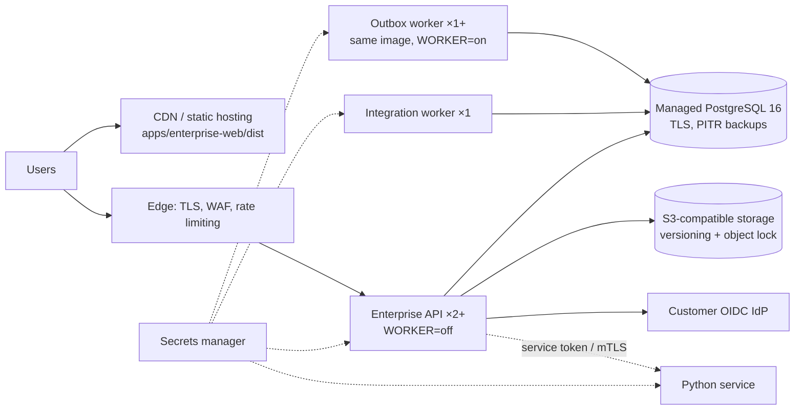

# Deployment guide (target, not done)

## Production overlay (2026-10-30) — written, NOT_RUN here

`docker-compose.prod.yml` + `deploy/Caddyfile` + `.github/workflows/ci.yml` describe one host running the four public surfaces behind
Caddy with automatic TLS, the API in `NODE_ENV=production` + `AUTH_MODE=oidc`, a separate migration job as the owner role, no seed,
no published port but 80/443, read-only containers. **Status: not executed in the build environment (no container runtime, no GitHub
account linked, no domain, no identity provider).** The first run on a real host is the owner's acceptance step for this file; until
then nothing here is "deployed", and nothing is production-ready.

```
cp .env.example .env            # fill every CHANGE_ME, the OIDC_* values and the four host names
docker compose -f docker-compose.yml -f docker-compose.prod.yml --profile prod up -d --build
docker compose -f docker-compose.yml -f docker-compose.prod.yml --profile prod logs -f api
curl -fsS https://$API_HOST/health
```

The Founder Studio is deliberately not in the overlay (ADR-0001 §3: localhost-bound launcher, never published).

**Nothing has been deployed.** This is the intended topology for a first hosted pilot, written so that a platform engineer can start
from it. Each element names what the code already supports and what is missing.



| Element | Today | Needed for the pilot |
|---|---|---|
| Web app | static bundle (`apps/enterprise-web/dist`), server sets CSP | host on a CDN with the same CSP headers; point `connect-src` at the API origin |
| API | stateless except the per-process rate limiter; `HOST`/`PORT` configurable; `WORKER=off` disables the in-process outbox worker (`services/enterprise-api/src/main.ts:34`) | ≥2 instances behind a TLS load balancer; health check `GET /health` |
| Outbox worker | runs in the API process; `FOR UPDATE SKIP LOCKED` lets several run safely (`worker/outbox.ts`) | run as its own deployment; it already connects as its own DB role `empathia_worker` (`WORKER_DATABASE_URL`, migration 0008) |
| Integration worker | `services/integration-worker/main.mjs` | dedicated non-human account; only after a VERIFIED adapter exists does it touch a real system |
| Database | migrations with sha256 guard; RLS; owner vs runtime roles | managed PostgreSQL 16, TLS `verify-full`, PITR, separate migration job using the owner role, `statement_timeout` |
| Evidence storage | `LocalObjectStore` | implement `S3ObjectStore` (CONTRACT_ONLY today) with versioning and object lock; malware scanning |
| Identity | dev IdP (refused in production); **OIDC verifier implemented** (`auth/oidc.ts`: RS256/PS256/ES256 against a JWKS with rotation, iss/aud/exp/nbf, subject → person, verified-email binding; `tests/security/oidc.test.mjs` 4/4 against a local JWKS) | register the client at the owner's identity provider and verify against it (NOT yet done); backend-for-frontend with HttpOnly cookies |
| Secrets | generated files under `.local/` | secrets manager; rotation for DB passwords, service tokens, adapter credentials |
| Observability | JSON logs with correlation ids, `/health` | log shipping, metrics, tracing, alerts (`MONITORING_LOGGING_ALERTING.md`) |

Release procedure (to establish): build once in CI, run `node scripts/verify-all.mjs`, tag, build images with digests, run migrations as
a one-off job with the owner role, roll out API/workers, smoke-test `/health` and a sign-in, keep the previous images for rollback.
Database rollback is forward-only: write a corrective migration; never edit an applied one.
