# Demonstrator index

*Every launchable demonstration in the founder workspace, opened from disk and captured on 2026-10-26 by `scripts/demonstrators/capture.mjs` (network blocked during capture). All data synthetic. Nothing here is authorized for external distribution.*

| demonstrator | version | loads offline | classification |
|---|---|---|---|
| [V2.5 lifecycle · Empathia Living Campus (synthetic data)](#founder-2.5.4) | 2.5.4 development build (branch founder/2.5.4, b8986d1) | PASS | INTERNAL_ONLY |
| [Investor demonstration · Empathia Living Campus (synthetic data)](#inv-2.5.3-rc3-offline) | 2.5.3 rc3 (frozen) | PASS | INVESTOR_DISCLOSABLE (after security and owner approval) |
| [Investor demonstration · Empathia Living Campus (synthetic data)](#inv-2.5.3-rc3-live) | 2.5.3 rc3 (frozen, not deployed) | PASS | INVESTOR_DISCLOSABLE (after security and owner approval) |
| [V2.5 lifecycle · Empathia Living Campus (synthetic data)](#eng-2.5.3-rc3) | 2.5.3 rc3 (frozen) | PASS | CONFIDENTIAL_TECHNICAL |
| [Investor demonstration · Empathia Living Campus (synthetic data)](#inv-2.5.2-rc1) | 2.5.2 rc1 (frozen) | PASS | INTERNAL_ONLY (superseded candidate) |
| [Investor demonstration · Empathia Living Campus (synthetic data)](#inv-2.5.1.1) | 2.5.1.1 (frozen) | PASS | INTERNAL_ONLY (superseded) |
| [Mission Control · Empathia Living Campus (synthetic data)](#v1.4.1) | 1.4.1 | PASS | INTERNAL_ONLY |
| [Mission Control · Empathia Living Campus (synthetic data)](#campus-history) | 0.1 … 1.4.1 (30 files) | PASS | INTERNAL_ONLY (history) |
| [Collabora-sing SyncLab 3D](#synclab-3d) | 1.1 | PASS | INTERNAL_ONLY |
| [SyncLab Pilot Analyzer](#synclab-analyzer) | pilot kit 1.0 | PASS | INTERNAL_ONLY |
| [Collabora-sing SyncLab](#synclab-app) | 0.2 | PASS | INTERNAL_ONLY |
| [Empathia V2.5 — Design Review](#v2.5-design-portal) | V2.5 production candidate design | PASS | INTERNAL_ONLY (founder-supplied input; origin under review) |
| [Empathia V2.4.1 | Unified Operations & Engineering](#v2.4.1-run) | 2.4.1 | PASS | INTERNAL_ONLY (founder-supplied input) |
| [Empathia V2.3 | Vertical Slice Lab](#v2.3-slice) | 2.3 | PASS | INTERNAL_ONLY (founder-supplied input) |
| [Empathia FI 1.4 x Lite | Synthetic Preview](#fi14-preview) | FI 1.4 preview | PASS | INTERNAL_ONLY (founder-supplied input) |

## V2.5 lifecycle · Empathia Living Campus (synthetic data)

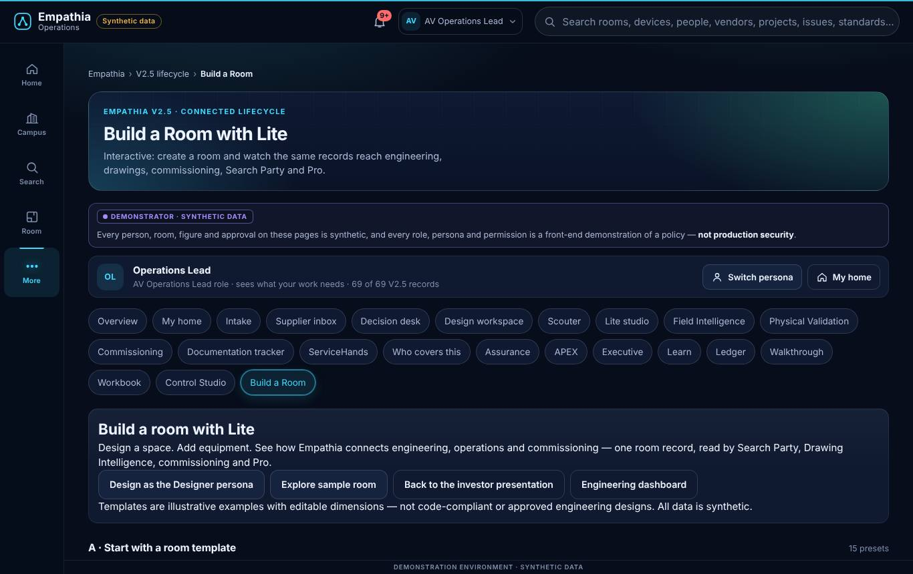

| field | value |
|---|---|
| version | 2.5.4 development build (branch founder/2.5.4, b8986d1) |
| file | `empathia-technologies/apps/founder-studio/dist/demonstrators/founder/Empathia-Founder-Edition.html` |
| SHA-256 | `ecdf64be4de7cda5096c8dd7902814e26a7b1fe5d693799f9d489fbbddcbe1ee` |
| title on load | V2.5 lifecycle · Empathia Living Campus (synthetic data) |
| launch | Open it from the Founder Studio (recommended: the launcher), or open the file in Chrome/Edge/Safari. |
| supported interactions | All 18 product surfaces; every persona including Product Architect; Build a Room; fault injection for the architect persona (development edition). |
| data source | synthetic seed generated in the page |
| synthetic-data disclosure | all people, rooms, figures and approvals are synthetic |
| known limitations | Not a release candidate: not gated, packaged or reviewed as a release. Authorization is a front-end demonstration. |
| dependencies | a modern browser; no network |
| test evidence | founder-townhall e2e 25/25 (this program); room suite 95/95 on this build (2.5.4 branch); full 2.5.x gate NOT_RUN on this build |
| rights / distribution | INTERNAL_ONLY |
| source | `Empathia_V25/work/source-254/src` |
| loads offline (this capture) | PASS |

## Investor demonstration · Empathia Living Campus (synthetic data)

| field | value |
|---|---|
| version | 2.5.3 rc3 (frozen) |
| file | `Empathia_V25/Empathia_Investor_Release_253_rc3/Offline_Investor_Edition/Empathia-Living-Campus-V2.5.3-offline.html` |
| SHA-256 | `ecbde0bba17eafc9e5bcf98b57d15fbbb2378bac66d017c7a402194e78307756` |
| title on load | Investor demonstration · Empathia Living Campus (synthetic data) |
| launch | Open the file in a browser. |
| supported interactions | Investor landing, guided tour, Build a Room, product surfaces for the investor personas. |
| data source | synthetic |
| synthetic-data disclosure | all people, rooms, figures and approvals are synthetic |
| known limitations | Page-API security NOT VERIFIED — EXTERNAL TEST REQUIRED. Distribution not authorized. |
| dependencies | browser |
| test evidence | builder gate 85/85, shipped-edition 44/44, three-edition 23/23; separate-AI release review VERIFIED WITH CONDITIONS |
| rights / distribution | INVESTOR_DISCLOSABLE (after security and owner approval) |
| source | `tag v2.5.3-rc3 (cf86866)` |
| loads offline (this capture) | PASS |

## Investor demonstration · Empathia Living Campus (synthetic data)

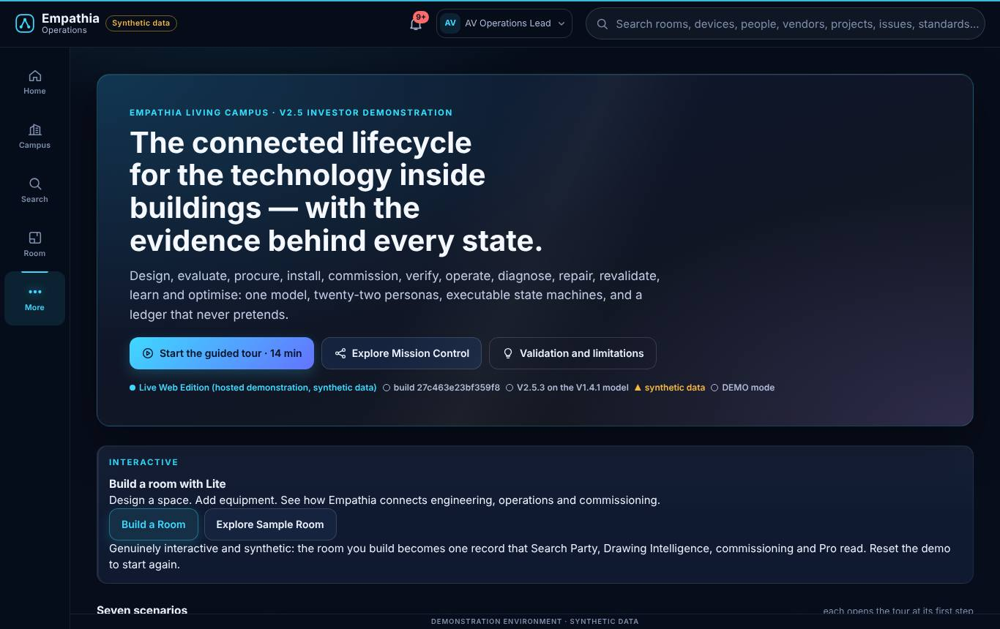

| field | value |
|---|---|
| version | 2.5.3 rc3 (frozen, not deployed) |
| file | `Empathia_V25/Empathia_Investor_Release_253_rc3/Live_Web_Edition/index.html` |
| SHA-256 | `9d6e53ef9f5a4e797b3be16c08f041b7c0c0766abbadb5186296ac925a09f2f1` |
| title on load | Investor demonstration · Empathia Living Campus (synthetic data) |
| launch | Serve the folder from a static web host (not deployed). |
| supported interactions | As the offline edition. |
| data source | synthetic |
| synthetic-data disclosure | all people, rooms, figures and approvals are synthetic |
| known limitations | Not deployed. Same security status as the offline edition. |
| dependencies | a static host |
| test evidence | as rc3 |
| rights / distribution | INVESTOR_DISCLOSABLE (after security and owner approval) |
| source | `tag v2.5.3-rc3` |
| loads offline (this capture) | PASS |

## V2.5 lifecycle · Empathia Living Campus (synthetic data)

| field | value |
|---|---|
| version | 2.5.3 rc3 (frozen) |
| file | `Empathia_V25/Empathia_Engineer_Edition_253_rc3/Private_Engineer_Edition/Empathia-Living-Campus-V2.5.3-engineer-private.html` |
| SHA-256 | `604cc7486e4a63a214c6ea471d8dc41fb826060483f24ee8dbd88df8aecb56f7` |
| title on load | V2.5 lifecycle · Empathia Living Campus (synthetic data) |
| launch | Open the file in a browser (authorized technical reviewers only). |
| supported interactions | Inspection panel and fault injection for the engineering personas. |
| data source | synthetic |
| synthetic-data disclosure | all people, rooms, figures and approvals are synthetic |
| known limitations | Controlled distribution only. |
| dependencies | browser |
| test evidence | three-edition gate 23/23 including the room suite and town-hall e2e |
| rights / distribution | CONFIDENTIAL_TECHNICAL |
| source | `tag v2.5.3-rc3` |
| loads offline (this capture) | PASS |

## Investor demonstration · Empathia Living Campus (synthetic data)

| field | value |
|---|---|
| version | 2.5.2 rc1 (frozen) |
| file | `Empathia_V25/Empathia_Investor_Release_252/Offline_Investor_Edition/Empathia-Living-Campus-V2.5.2-offline.html` |
| SHA-256 | `86bbf66af2f2e166aa965224511cc8fc5582a6afd189886510a28a9be500717b` |
| title on load | Investor demonstration · Empathia Living Campus (synthetic data) |
| launch | Open the file. |
| supported interactions | Control Studio, Collaboro-Sing, Frontline, Onboard, service desk. |
| data source | synthetic |
| synthetic-data disclosure | all people, rooms, figures and approvals are synthetic |
| known limitations | Superseded by 2.5.3 for Build a Room; security NOT VERIFIED. |
| dependencies | browser |
| test evidence | 2.5.2 gates; separate-AI review |
| rights / distribution | INTERNAL_ONLY (superseded candidate) |
| source | `tag v2.5.2-rc1` |
| loads offline (this capture) | PASS |

## Investor demonstration · Empathia Living Campus (synthetic data)

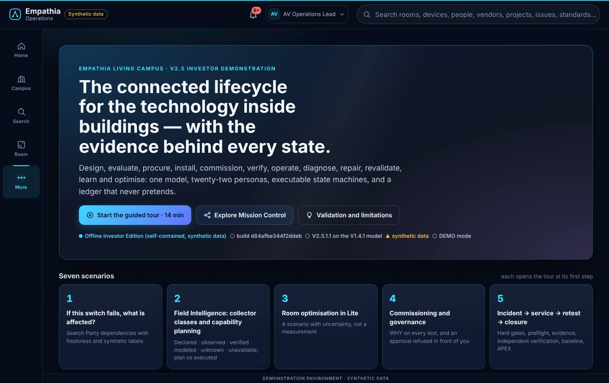

| field | value |
|---|---|
| version | 2.5.1.1 (frozen) |
| file | `Empathia_V25/Empathia_Investor_Release_2511/Offline_Investor_Edition/Empathia-Living-Campus-V2.5.1.1-offline.html` |
| SHA-256 | `b2e82e79dbe977e5fbb2999e45db33159f9a547737936d27777d9809c29609a2` |
| title on load | Investor demonstration · Empathia Living Campus (synthetic data) |
| launch | Open the file. |
| supported interactions | V2.5 lifecycle and the commissioning framework. |
| data source | synthetic |
| synthetic-data disclosure | all people, rooms, figures and approvals are synthetic |
| known limitations | Superseded. |
| dependencies | browser |
| test evidence | 2.5.1.1 gates; separate-AI reviews |
| rights / distribution | INTERNAL_ONLY (superseded) |
| source | `branch patch/2.5.1.1` |
| loads offline (this capture) | PASS |

## Mission Control · Empathia Living Campus (synthetic data)

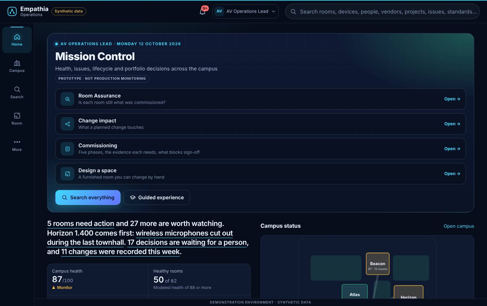

| field | value |
|---|---|
| version | 1.4.1 |
| file | `Empathia_V25/baseline_v141_readonly/Empathia_Living_Campus_v1.4.1-nomedia.html` |
| SHA-256 | `a9fd8eaa0a6f439366d4ab43665c5bf935b6b67a7fa3ffad13b042d9b2d40b33` |
| title on load | Mission Control · Empathia Living Campus (synthetic data) |
| launch | Open the file. |
| supported interactions | The V1.4.1 product surfaces (Search Party, Pro, Lite, Learn, SIGNAL, integrations hub). |
| data source | synthetic |
| synthetic-data disclosure | all people, rooms, figures and approvals are synthetic |
| known limitations | Superseded by V2.5; kept read-only as the canvas. |
| dependencies | browser |
| test evidence | its release gate logs (empathia-campus/gates141-release) |
| rights / distribution | INTERNAL_ONLY |
| source | `empathia-campus tag v1.4.1` |
| loads offline (this capture) | PASS |

## Mission Control · Empathia Living Campus (synthetic data)

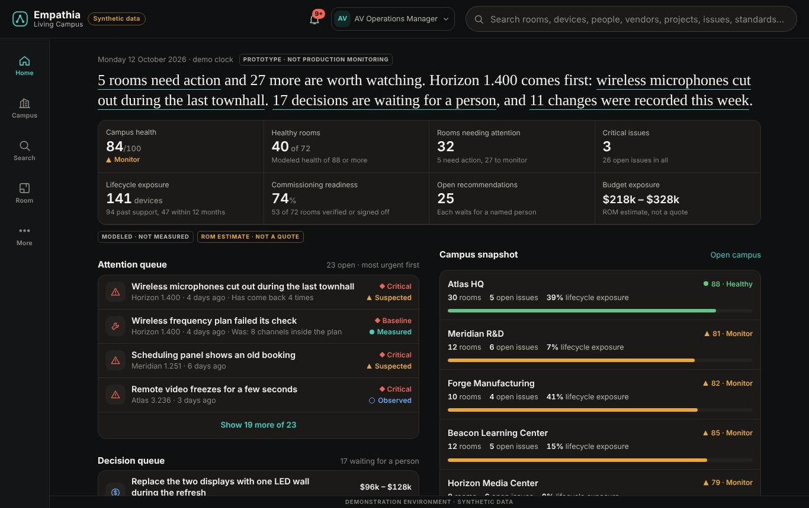

| field | value |
|---|---|
| version | 0.1 … 1.4.1 (30 files) |
| file | `empathia-campus/dist/Empathia-Living-Campus-v1.0.html` |
| SHA-256 | `aa3881e3d903562dbd68d57bcb1e63716dced324638b23cf74517928881eee49` |
| title on load | Mission Control · Empathia Living Campus (synthetic data) |
| launch | Open any file in empathia-campus/dist. |
| supported interactions | Each version as released. |
| data source | synthetic |
| synthetic-data disclosure | all people, rooms, figures and approvals are synthetic |
| known limitations | Historical; some builds embed media whose rights are not established (the -nomedia builds do not). |
| dependencies | browser |
| test evidence | their own gate logs (empathia-campus/gates*) |
| rights / distribution | INTERNAL_ONLY (history) |
| source | `empathia-campus` |
| loads offline (this capture) | PASS |

## Collabora-sing SyncLab 3D

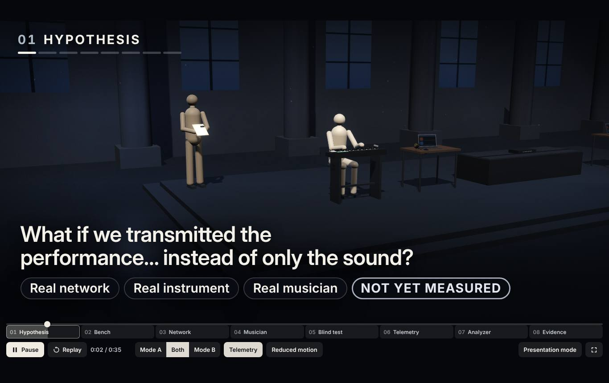

| field | value |
|---|---|
| version | 1.1 |
| file | `collabora-sing-synclab-3d/dist/Collabora-sing-SyncLab-3D.html` |
| SHA-256 | `e24a1180f07b6b6bdcf055e7527f00196abe867c83d1024648c6ce36bd956dd8` |
| title on load | Collabora-sing SyncLab 3D |
| launch | Open the file. |
| supported interactions | 3D explainer of the remote rehearsal lab. |
| data source | synthetic |
| synthetic-data disclosure | all people, rooms, figures and approvals are synthetic |
| known limitations | An explainer, not the lab. |
| dependencies | browser |
| test evidence | collabora-sing-synclab-3d/test |
| rights / distribution | INTERNAL_ONLY |
| source | `collabora-sing-synclab-3d/src` |
| loads offline (this capture) | PASS |

## SyncLab Pilot Analyzer

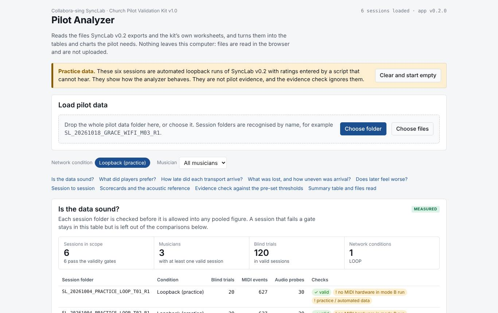

| field | value |
|---|---|
| version | pilot kit 1.0 |
| file | `SyncLab-Pilot-Analyzer.html` |
| SHA-256 | `ff34fc8fdaebd4a96a1ae6bbf48aba7bdc0a65c8f1aeaed023f973d1b97bc28b` |
| title on load | SyncLab Pilot Analyzer |
| launch | Open the file. |
| supported interactions | Analyse pilot results from the workbook. |
| data source | practice data |
| synthetic-data disclosure | all people, rooms, figures and approvals are synthetic |
| known limitations | No pilot results exist yet. |
| dependencies | browser |
| test evidence | kit QA (see the pilot kit) |
| rights / distribution | INTERNAL_ONLY |
| source | `top level` |
| loads offline (this capture) | PASS |

## Collabora-sing SyncLab

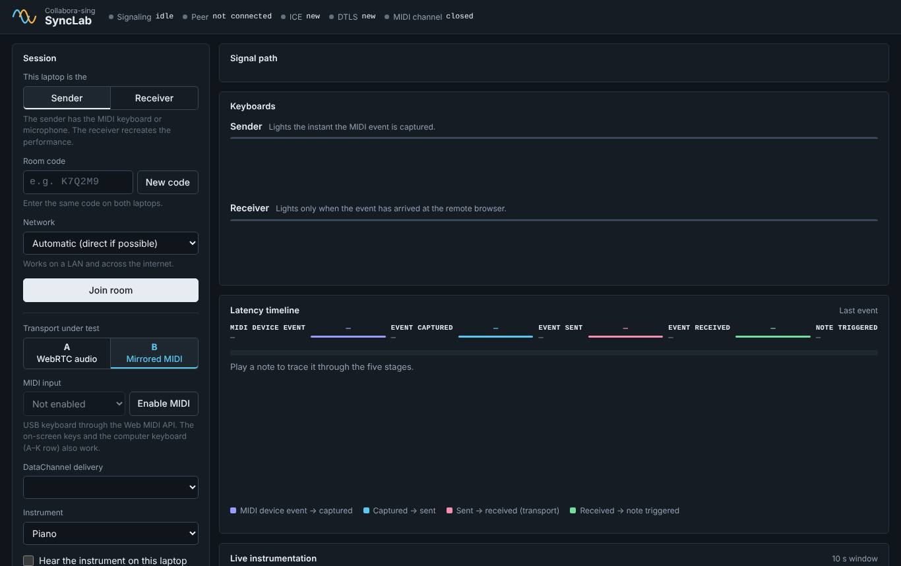

| field | value |
|---|---|
| version | 0.2 |
| file | `collabora-sing-synclab/public/index.html` |
| SHA-256 | `8a9313a41c212fd2bad990869942736aa49349fc76053270eee9759606b84818` |
| title on load | Collabora-sing SyncLab |
| launch | node collabora-sing-synclab/server/index.js, then open two browsers (local integration test only). |
| supported interactions | Two-browser rehearsal with MIDI, transport and blind A/B. |
| data source | live audio between browsers on one machine |
| synthetic-data disclosure | all people, rooms, figures and approvals are synthetic |
| known limitations | LOCAL_INTEGRATION_TEST on loopback only; no pilot results. |
| dependencies | Node, a signalling server |
| test evidence | unit 7/7 (re-run 23 Oct) |
| rights / distribution | INTERNAL_ONLY |
| source | `collabora-sing-synclab` |
| loads offline (this capture) | PASS |

## Empathia V2.5 — Design Review

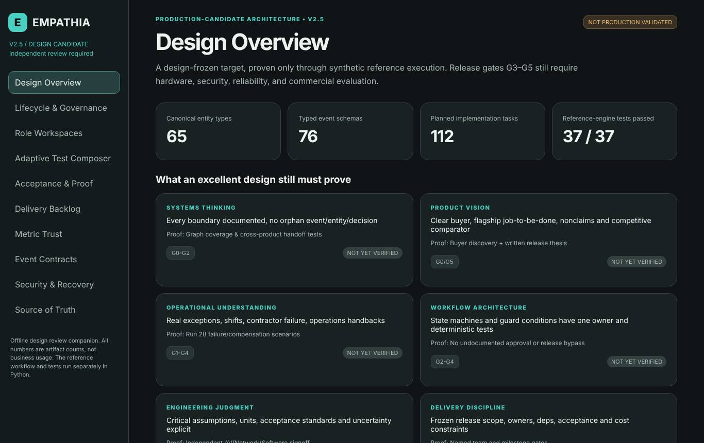

| field | value |
|---|---|
| version | V2.5 production candidate design |
| file | `Empathia_V25/inputs/Empathia_V2_5_Complete_Production_Candidate_Design_Package/Empathia_V2_5_Production_Candidate/Empathia_V2_5_Design_Review_Portal.html` |
| SHA-256 | `2f7204046ae2c0f2f675817f3e7e4455bd48de8abeb2fd3e0e3ab139c9adc532` |
| title on load | Empathia V2.5 — Design Review |
| launch | Open the file. |
| supported interactions | Read-only design review. |
| data source | design data |
| synthetic-data disclosure | all people, rooms, figures and approvals are synthetic |
| known limitations | A design preview, not working software. |
| dependencies | browser |
| test evidence | its own validate_v25.py |
| rights / distribution | INTERNAL_ONLY (founder-supplied input; origin under review) |
| source | `inputs` |
| loads offline (this capture) | PASS |

## Empathia V2.4.1 | Unified Operations & Engineering

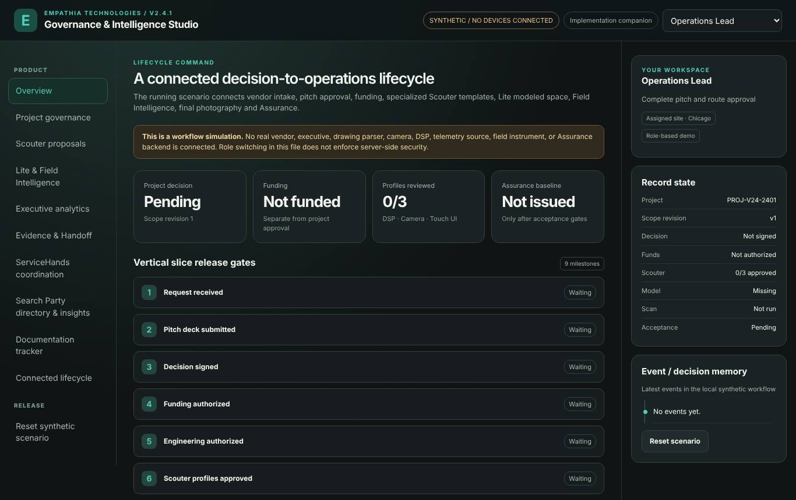

| field | value |
|---|---|
| version | 2.4.1 |
| file | `Empathia_V25/inputs/Empathia_V2_4_1_Synchronized_Interactive_Run.html` |
| SHA-256 | `13a5f3a9685ec1993d3b6e44e70539d8304a64d935643e2255425ede5b662665` |
| title on load | Empathia V2.4.1 | Unified Operations & Engineering |
| launch | Open the file. |
| supported interactions | A scripted interactive run of the lifecycle. |
| data source | synthetic |
| synthetic-data disclosure | all people, rooms, figures and approvals are synthetic |
| known limitations | Design reference. |
| dependencies | browser |
| test evidence | none recorded here |
| rights / distribution | INTERNAL_ONLY (founder-supplied input) |
| source | `inputs` |
| loads offline (this capture) | PASS |

## Empathia V2.3 | Vertical Slice Lab

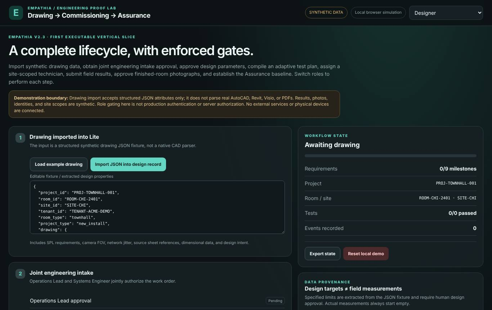

| field | value |
|---|---|
| version | 2.3 |
| file | `Empathia_V25/inputs/Empathia_V2_3_Executable_Contracts_P0_Plan_Vertical_Slice/Empathia_V2_3_Implementation_Proof/Empathia_V2_3_Running_Vertical_Slice.html` |
| SHA-256 | `77084b27696fdafbfce700ab08bb031bff9d7b4794c8d9b8372534ce6c77d40d` |
| title on load | Empathia V2.3 | Vertical Slice Lab |
| launch | Open the file. |
| supported interactions | A browser vertical slice of the contracts. |
| data source | synthetic |
| synthetic-data disclosure | all people, rooms, figures and approvals are synthetic |
| known limitations | Design reference. |
| dependencies | browser |
| test evidence | PROOF_RESULTS.json in its package |
| rights / distribution | INTERNAL_ONLY (founder-supplied input) |
| source | `inputs` |
| loads offline (this capture) | PASS |

## Empathia FI 1.4 x Lite | Synthetic Preview

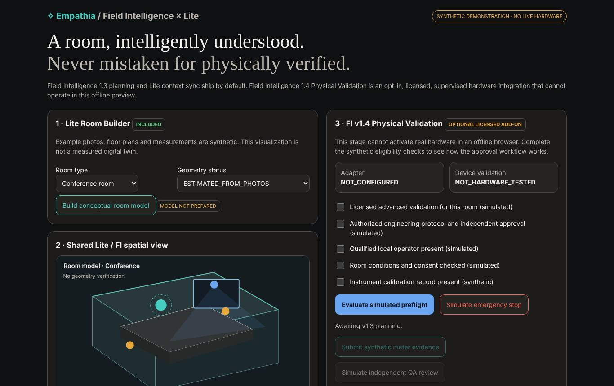

| field | value |
|---|---|
| version | FI 1.4 preview |
| file | `Empathia_V25/inputs/Empathia_Field_Intelligence_v1_4_Optional_Validation_Preview/Empathia_Claude_V2_5_Handoff/field_intelligence_v1_4/Empathia_FI14_Lite_Safety_Preview.html` |
| SHA-256 | `26a0292d455a41e0f1b9adda541bb76afa54257996996bcfcd8062b636f3213f` |
| title on load | Empathia FI 1.4 x Lite | Synthetic Preview |
| launch | Open the file. |
| supported interactions | Governance and safety gating of optional physical validation. |
| data source | synthetic |
| synthetic-data disclosure | all people, rooms, figures and approvals are synthetic |
| known limitations | Standalone synthetic UI companion; not the demonstrator. |
| dependencies | browser |
| test evidence | its qa/ folder |
| rights / distribution | INTERNAL_ONLY (founder-supplied input) |
| source | `inputs` |
| loads offline (this capture) | PASS |
