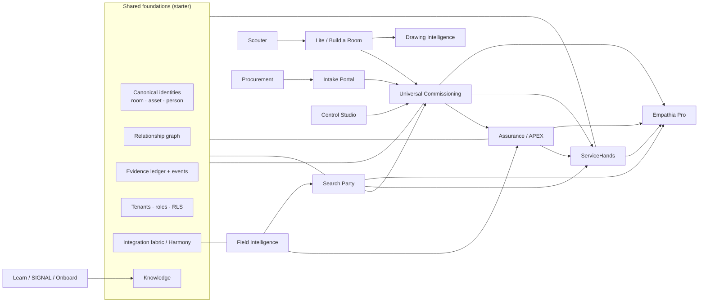

# Empathia — product and business architecture

Documentation set A of the founder program (directive section 13A). Every maturity statement below is copied from the recorded
evidence in `apps/founder-studio/src/data/products.ts` (which itself cites the 2.5.2 capability register and the 2.5.3 release report)
or from tests in this monorepo. Nothing is upgraded here. All data in every demonstrator and in the production starter is synthetic.
Nothing described here is production-ready, and no product has been independently audited, hardware-verified, production-validated
or customer-validated.

Contents: 1 Technical vision · 2 Capability map · 3 Eighteen-product inventory · 4 The seven-product commercialization strategy ·
5 Product dependency map · 6 Roles and personas · 7 Buyer-facing use cases · 8 First commercial slice: requirements and acceptance
criteria · 9 Maturity assessment · 10 Roadmap and delivery phases (proposal)

---

## 1. Company technical vision

In the founder's words (directive section 3): *"Empathia is an intelligent software platform for infrastructure, operational
workflows, physical spaces, assets, engineering evidence, people, projects and organizational knowledge. Its ultimate ambition is to
support the entire built environment. AV/IT is the initial commercial market, not the platform's long-term boundary."* And from the
final instruction: *"I do not want eighteen disconnected projects. I want one coherent Empathia ecosystem that can grow into an
intelligent operational platform for the entire built environment."*

What that means technically, as this repository implements it so far:

* **One canonical record per thing.** A room, a planned device, a revision, a test result, an issue and a work order each exist once,
  in one tenant-scoped PostgreSQL schema (`database/migrations/0001–0008`). Products are views and workflows over those records, never
  copies of them (directive 3.3: *"Do not create separate copies of canonical records merely to make different product screens appear
  operational"*).
* **Evidence before claims.** A result is never a bare PASS: it is `PASS_UNVERIFIED` until a different person verifies it
  (`packages/commissioning-engine/src/results.ts`, enforced again by `verification_is_independent` in
  `database/migrations/0003_commissioning_evidence.sql`). Live health is `NOT_MONITORED` until there is monitoring evidence.
* **Authority on the server.** Every permission is decided by the enterprise API from the person's membership, resolved from the
  database on every request (`services/enterprise-api/src/domain/platform.ts` `resolvePrincipal`), and enforced again by row-level
  security. Browsers only reflect it.
* **One relationship graph** connects people, rooms, devices, issues and work so that any product can answer "what is behind this, and
  what does it affect" (`packages/relationship-engine`).
* **Honest maturity everywhere.** Every product, integration and model carries its evidence state; unknown is reported as unknown.

## 2. Capability map — shared foundations

The shared foundations of directive 3.3, mapped to what implements them today. "Starter" = this monorepo's production starter (real
API, real PostgreSQL, server-side authorization). "Demonstrator" = the browser-only 2.5.4 Founder Edition (synthetic, in-page state).

| Foundation | Production starter (this repo) | Demonstrator only | Status |
|---|---|---|---|
| Canonical infrastructure model; site → building → room hierarchy | `app.tenant/site/building/room` (`0002_core.sql`); floors are a room attribute, no floor table | Full campus/floor model (`src/10-model.js`, `src/24-static-lite.js`) | STARTER (floors: SPECIFIED ONLY) |
| Asset and device identities | `app.planned_asset` with tenant-unique codes `PA-0001` (`app.next_code`, `0002_core.sql`); model history kept on swap | Device registry with makers, firmware, state | STARTER (planned assets only; no installed-asset register) |
| People, vendors, organizational relationships | `app.person`, `app.membership` (role + site scope), `GET /v1/people`, `GET /v1/roles` | Vendors, contacts, ownership coverage (Search Party) | STARTER (people/roles); vendors: DEMONSTRATOR ONLY |
| Projects and work orders | `app.project` (`0006_projects.sql`), `app.work_order` (`0003`) | Project delivery, budgets | STARTER |
| Tenant boundaries and RBAC | RLS FORCE on business tables (`app.tenant_rls`), composite FKs, authority checks (`auth/context.ts` `require`), 44 negative tests (`tests/security/authz.test.mjs`) | Persona switch in the page (`src/12-authz.js`) — a demonstration, not security | STARTER |
| Search Party relationship graph | `packages/relationship-engine` (130 relation types, `neighbourhood`, `impact`, `path`), `app.relationship`, `GET /v1/graph/:type/:id` with site-scoped visibility | Explorer levels A–D, intents (`src/60-search.js`) | STARTER (engine + API); UI: DEMONSTRATOR ONLY |
| Operational events and evidence ledger | 101 event contracts (`packages/event-contracts`), transactional outbox with retries/dead letter (`worker/outbox.ts`), content-addressed append-only evidence (`storage/objectStore.ts`, `app.evidence_object`) | In-page event log | STARTER |
| Knowledge Fabric | Permission-aware keyword search over `app.knowledge_document` (`domain/platform.ts` `knowledge`) | Learn cases and articles | STARTER (keyword only; no chunking/embeddings: SPECIFIED ONLY) |
| AI orchestration and retrieval | `POST /v1/ai/requests`: logged by prompt hash, permitted sources returned, generation `NOT_CONFIGURED` (501) | "Ask Empathia": 11 regex intents (`docs/algorithms/ENGINE_INVENTORY.md`) | STARTER (governance shell only; no model) |
| Assurance baselines | `packages/assurance-engine` (17 dimensions, gap vs drift, remedy precedence), `GET /v1/rooms/:room/assurance`; baseline written at ACCEPTED | Drift, APEX diagnosis (simulated) | STARTER (rules); no monitoring feed |
| Harmony engine | `integrations/contracts/src/harmony.ts` (authority, deny-by-default writes, dedupe, conflicts, retries, rate limits) | Simulated ownership guard (`v25-40-cs-engine.js`) | STARTER (with MOCK adapters only) |
| Commissioning applicability engine | `packages/commissioning-engine` (92 golden parity cases with the demonstrator) used server-side | Original in `src/v25-60-room.js`, `src/v25-096-cxuni.js` | STARTER |
| Integration registry | 83-entry catalogue (`integrations/contracts/INTEGRATION_REGISTRY.csv`) seeded as `CONTRACT_ONLY`; 3 local MOCK adapters | Integration hub pages | STARTER (no VERIFIED adapter) |
| Analytics and KPI framework | `GET /v1/reports/summary` (`domain/analytics.ts`): each ratio states its definition; operational performance `NOT_MONITORED` | Executive KPI passports | STARTER (starter KPIs only) |
| Design system | `packages/design-tokens`, `packages/ui`, used by `apps/enterprise-web` | Aurora theme (`v30-aurora.css`) | STARTER |
| Audit trail | `app.audit_event` append-only; denials audited in their own transaction | In-page history | STARTER |
| Notification and workflow services | Notifications written by the outbox worker (`notificationHandler`); lifecycle gates (`lifecycle.ts`) | Inbox, routing | STARTER (in-app only; no e-mail/Teams delivery) |

## 3. The eighteen-product inventory

Ladder columns are the first four rungs of the evidence ladder (S = specified, I = implemented, D = demonstrated, B = builder-tested;
YES / PARTIAL / NO). The four higher rungs — independently audited, hardware-verified, production-validated, customer-validated — are
**NO for every product**. "Builder suites" = the 2.5.2 register's count of demonstrator test suites that name the product's routes
(passed / not run). The directive asks for a classification (functioning / partially functioning / prototype / specification only /
not yet implemented); the one given here is derived from the recorded state: `SIMULATED_FUNCTIONAL` on synthetic data is a
**prototype**, with "partial" where implementation is recorded as PARTIAL.

Founder Studio destinations are `#/<slug>` in the studio (`apps/founder-studio/src/nav.ts`); demonstrator routes are hash routes in
the Founder Edition.

### The seven initial enterprise products

**01 Search Party** — *Find the person, the room or the system behind anything, and see how it is all connected.* People, ownership
and support coverage for any room; a relationship explorer with edge-level visibility. Primary users: operations leads, service
managers, engineers. Demonstrated at `#/search`, `#/search/graph`, `#/v25/coverage`, `#/service/coverage`; studio `#/search-party`.
Ladder S YES · I YES · D YES · B PARTIAL; builder suites 42 (36 pass, 6 not run); acceptance: none agreed. Classification: prototype.
Starter code: relationship engine and `GET /v1/graph/:type/:id`. Not there: directory integration; Teams/Outlook links only open a client.

**02 ServiceHands** — *Small field changes done properly: routed, prepared, executed and verified with evidence.* Request and
work-order lifecycle with eligibility gates; closing a work order never passes a test. Primary users: service managers, technicians,
installers. Demonstrated at `#/servicehands`, `#/v25/service`, `#/service`; studio `#/servicehands`. Ladder S YES · I YES · D YES ·
B PARTIAL; builder suites 17 (14 pass, 3 not run); acceptance: none agreed. Classification: prototype. Starter code: work orders
(`POST /v1/issues/:issue/work-orders`, `POST /v1/work-orders/:wo/close`). Not there: offline field drafts, server photo upload in the field app.

**03 Intake Portal** — *Turn a request with photos, plans and dimensions into an engineering brief and a funded decision.* Requests,
triage, supplier acknowledgement, decision desk bound to a scope revision. Primary users: requestors, operations leads, finance,
executives. Demonstrated at `#/v25/intake`, `#/intake`, `#/v25/vendor`, `#/v25/decisions`; studio `#/intake`. Ladder S YES · I YES ·
D YES · B PARTIAL; builder suites 16 (14 pass, 2 not run); acceptance: none agreed. Classification: prototype. Starter code: projects
only (`/v1/projects`); **no request or decision module** — finance authority is a browser role check in the demonstrator.

**04 Empathia Pro** — *The operational view of every room and device.* Command center, registries, issues, operations and executive
KPI passports. Primary users: operations leads, executives, service managers. Demonstrated at `#/pro`, `#/pro/assets`, `#/pro/planned`,
`#/v14/operations`, `#/v25/exec`; studio `#/pro`. Ladder S YES · I YES · D YES · B PARTIAL; builder suites 47 (41 pass, 6 not run);
acceptance: none agreed. Classification: prototype. Starter code: operational read model (`/v1/read/rooms`), KPI summary
(`/v1/reports/summary`), enterprise web app (`apps/enterprise-web`). Not there: live device data — monitoring is synthetic.

**05 Assurance / APEX** — *Keep the accepted baseline honest: drift against it, and evidence-cited diagnosis when something breaks.*
Primary users: operations leads, systems engineers, service managers. Demonstrated at `#/v25/assurance`, `#/v25/apex`, `#/assurance`,
`#/agent`; studio `#/assurance`. Ladder S YES · I YES · D YES · B PARTIAL; builder suites 45 (41 pass, 4 not run); acceptance: none
agreed. Classification: prototype. Starter code: `packages/assurance-engine` and `GET /v1/rooms/:room/assurance` (dimensions without
evidence report `unknown`). Not there: APEX hypotheses and action tiers are simulation; no runbook execution; no monitoring feed.

**06 Field Intelligence** — *Authorized, read-only discovery and safe measurement planning, with optional licensed physical
validation.* Primary users: commissioning engineers, systems engineers, security administrators (authorization). Demonstrated at
`#/v25/fi`, `#/v25/fipv`, `#/v14/robot`; studio `#/field-intelligence`. Ladder S YES · I PARTIAL · D YES · B YES; builder suites 9
(9 pass, 0 not run); acceptance: none agreed. Classification: partial prototype. Starter code: the common adapter contract, three MOCK
adapters and the sync path (`integrations/`, `POST /v1/integrations/:key/sync`); observations are `SYNTHETIC_MOCK`. Not there: no
measurement has been taken; no real camera or meter control; the V1.3 collector's origin needs chain-of-title review
(`provenance/chain-of-title/CHAIN_OF_TITLE_CHECKLIST.md`).

**07 Universal Intelligent Five-Phase Commissioning** — *The right tests for this room, the evidence each needs, and nothing passed
without it.* Primary users: commissioning engineers, QA reviewers, systems engineers. Demonstrated at `#/v25/commissioning`,
`#/v25/cxworkbook`, `#/v25/tracker`, `#/commissioning`; studio `#/commissioning`. Ladder S YES · I YES · D YES · B YES; builder suites
28 (24 pass, 4 not run); acceptance artefact: `TEST_LIBRARY_MANIFEST.json` (33 base + 61 pack definitions, 11 packs). Classification:
prototype — the most mature product. Starter code: `packages/commissioning-engine` (128/128 tests incl. 92 golden parity cases) used
server-side; results, verification, deficiencies, acceptance gates in the API. Not there: **no field test has been executed**;
definitions are not executions; workbook export (JSON/CSV/.xlsx) exists in the demonstrator only.

### The eleven additional product experiences

| # | Product | Purpose (as recorded) | Primary users | Demonstrated at / studio | Ladder S·I·D·B | Builder suites | Classification | Starter code |
|---|---|---|---|---|---|---|---|---|
| 08 | Empathia Lite | Rooms, floors and campuses in 2D and 3D, with a confidence it never exceeds | designers, systems engineers | `#/lite`, `#/v25/lite`, `#/studio/new`, `#/v14/geometry` · studio `#/build-a-room` | YES·YES·YES·PARTIAL | 55 (49 / 6) | prototype | room geometry, templates, devices, plan view (`commissioning-engine/src/design.ts`, `geometry.ts`; web `FloorPlan.tsx`); no 3D, no UE5 |
| 09 | Scouter | Ranked, explained equipment shortlist from sourced, staleness-aware data | designers, engineers | `#/scouter`, `#/v25/scouter` · `#/scouter` | YES·YES·YES·PARTIAL | 19 (16 / 3) | prototype (fictional makers only) | none |
| 10 | Procurement | Budgets, BOMs, substitutions, receiving tied to the design revision | project managers, finance | `#/budget`, `#/v25/project`, `#/projects` · `#/procurement` | YES·PARTIAL·PARTIAL·PARTIAL | 23 (19 / 4) | partial prototype; product boundary not specified | projects only |
| 11 | Drawing Intelligence | Drawings generated from the design, flagged when an approved drawing no longer matches | designers, systems engineers | `#/v25/design`, `#/v25/build` · `#/drawing-intelligence` | YES·PARTIAL·PARTIAL·PARTIAL | 20 (16 / 4) | partial prototype (no CAD/BIM/DWG/IFC import) | drawing revisions: generate, approve, REVIEW_REQUIRED on input change |
| 12 | Control Studio | Design, simulate, publish and commission a room's control system — every device virtual until proven | control engineers | `#/v25/cstudio`, `#/control`, `#/scheduler` · `#/control-studio` | YES·YES·YES·YES | 14 (12 / 2) | prototype; CS-AT 44 of 45 pre-agreed tests pass, CS-AT-41 not passed or not run | none |
| 13 | Empathia Learn | Cases, labs and practice written from what happened in the estate | all staff | `#/learn`, `#/v25/learn`, `#/learn/labs` · `#/learn` | YES·YES·YES·PARTIAL | 30 (26 / 4) | prototype (synthetic content) | knowledge documents search |
| 14 | SIGNAL | A story mode that teaches the platform through a playable season | all staff | `#/learn/signal`, `#/learn/story` · `#/signal` | YES·YES·YES·PARTIAL | 13 (9 / 4) | prototype; Season 1 only — the 12-season corpus is SOURCE_MISSING | none |
| 15 | Empathia Onboard | A new hire's first connected milestone | new hires, managers | `#/v25/onboard`, `#/lite/guides` · `#/onboard` | YES·PARTIAL·PARTIAL·PARTIAL | 8 (6 / 2) | partial prototype; 25 MVP tests specified | none |
| 16 | Experiences / UE5 | Guided, cinematic walk-throughs; an Unreal Engine path is planned | buyers, executives | `#/tours`, `#/v25/walkthrough` · `#/experiences` | PARTIAL·PARTIAL·PARTIAL·PARTIAL | 14 (11 / 3) | browser tours only; **UE5 not yet implemented** (UE5_NOT_RUN) | none |
| 17 | Collaboro-Sing | Remote rehearsal and practice for musicians, measured honestly | musicians, ensemble leaders | `#/v25/sing` · `#/collaboro-sing` | YES·YES·YES·PARTIAL | 2 (2 / 0) | prototype on its own tenant; 15-test matrix PROPOSED | none |
| 18 | Frontline | Frontline teams (church and community settings) running their rooms with guided steps | volunteer and community operators | `#/v25/frontline` · `#/frontline` | YES·YES·YES·PARTIAL | 1 (1 / 0) | prototype on its own tenant; 15-test matrix PROPOSED | none |

**Onboard discrepancy (recorded, not corrected in the frozen register):** the 2.5.2 register says "Guides page only", but the
`#/v25/onboard` milestone page shipped in 2.5.2 rc1 (commit `6669fda`). `products.ts` records the correction; this document repeats it.
The register's state for Onboard is `QUEUED` and its proof level `NOT_ASSESSED`.

Recorded state notes: every product except Onboard (QUEUED), Experiences (QUEUED) and Drawing Intelligence (MOCKED_UI_ONLY in 2.5.2 →
drawing set and revision checks in Build a Room in 2.5.3) is `SIMULATED_FUNCTIONAL` with proof level `OFFLINE_SYNTHETIC`.

## 4. The seven-product initial commercialization strategy

Directive 3.1 names seven initial enterprise products and requires them to share identities, asset information, permissions, event
contracts, evidence models and relationship data. The strategy proposed here (a proposal for the founder, not a decision) sells them as
**one lifecycle**, not seven tools:

`Intake Portal` (a need becomes a funded, scoped decision) → `Universal Commissioning` + Lite/Build a Room (the design is classified,
its tests compiled, it is installed and commissioned with evidence) → `Assurance / APEX` (the accepted baseline is kept honest) →
`ServiceHands` (deficiencies and drift become field work that is verified, not just closed) → `Empathia Pro` (the operational view
across every room) — with `Search Party` (who and what is connected) and `Field Intelligence` (authorized read-only discovery) feeding
every step.

| Product | Depends on (other products) | Needs from the platform | Commercial readiness gate (proposal) |
|---|---|---|---|
| Universal Commissioning | Lite (room design), Search Party (devices/people) | applicability engine, evidence ledger, verification separation, roles | first field pilot: real tests executed and independently verified on real rooms |
| ServiceHands | Commissioning (deficiencies), Assurance (drift), Search Party (who) | work orders, evidence, notifications, mobile/offline field client | offline field client + server photo evidence |
| Empathia Pro | all the above | read models, KPI framework, monitoring feed | a VERIFIED monitoring or ITSM integration (no synthetic telemetry) |
| Assurance / APEX | Commissioning (accepted baselines), Field Intelligence (observations) | baselines, observation ingest from VERIFIED adapters | one VERIFIED read-only source feeding real observations |
| Search Party | — (foundation) | relationship graph, directory integration | directory (identity provider) integration, read-only |
| Field Intelligence | Search Party (canonical matching) | adapter contract, Harmony, authorization records | authorized read-only discovery in a verified test environment |
| Intake Portal | Search Party, Pro | request and decision modules with server-side approval authority | build the request/decision modules (none in the starter) |

Recommended order to commercialize (risk-first): **Commissioning + Build a Room** (most mature; the starter's vertical slice already
implements it server-side) → **ServiceHands** (closes the deficiency loop) → **Search Party** (needed by everything) → **Pro** and
**Assurance** (need real data feeds) → **Intake** (needs new modules) → **Field Intelligence** (needs authorized environments and
legal review of collection).

## 5. Product dependency map

Collaboro-Sing and Frontline run on their own tenants in the demonstrator and share only the shell and design system today.
Experiences/UE5 depends on a spatial contract that does not exist yet (`spatial/ue5-contracts`, SPECIFIED ONLY at most).

## 6. User roles and personas

From `packages/domain-data/data/V25_PERSONAS.json` (extracted unchanged from the demonstrator). "Seeded" = the starter seed creates one
synthetic person for the role in tenant `empathia-demo` (`services/enterprise-api/src/db/seed.ts` `DEMO_ROLES`); a second,
South-campus-only service technician exists to test site scope. `architect` (`*`) is a demonstration persona and is deliberately not
seeded into the enterprise tenants.

| Role | Label | Home | Authorities | Seeded |
|---|---|---|---|---|
| requestor | Requestor / Employee | My requests | request.submit, request.withdraw | yes |
| vendor | Supplier / Partner contact | Vendor inbox | vendor.acknowledge, vendor.quote | no |
| opslead | Operations Lead | Operational decision desk | pitch.submit, approver.select, route.internal, brief.approve, handoff.accept, window.approve, request.desk_update, issue.assign | yes |
| syseng | Systems Engineer | Engineering approval desk | brief.approve, design.release, extraction.review, protocol.approve, plan.compile, baseline.approve, rfi.resolve, room.design, room.classify.approve, room.design.approve | yes |
| exec | Executive / Sponsor | Executive Mission Control | project.decide | yes |
| finance | Finance / Budget Authority | Investment decisions | funding.authorize, funding.withdraw | yes |
| bpm | Business Project Manager | My portfolio | scope.revise | no |
| ipm | Integrator Project Manager | Delivery portfolio | parts.receive | no |
| designer | Designer / CAD / Revit | Design studio | design.revise, design.submit, divr.record, lite.edit, scouter.propose, room.design | yes |
| dsp_eng | DSP / Audio Engineer | Audio template review | review.dsp, test.verify.audio | yes |
| video_eng | Video / Camera Engineer | Camera template review | review.camera, test.verify.video | yes |
| control_eng | Control / UI Engineer | Touch UI template review | review.touch, test.verify.control | yes |
| svcmgr | Service Manager | Service delivery command center | service.triage, service.assign, service.close, service.reopen, field.authorize, issue.assign | yes |
| service | Service Technician | My work + my sites | work.accept, work.start, work.evidence, field.scan, photo.submit | yes (+ a South-campus-only person) |
| installer | Installer | Field package | work.evidence, deviation.raise, photo.submit | yes |
| cxeng | Commissioning Engineer | My commissioning | test.verify, deficiency.open, tests.verify.all, fipv.review, service.verify | yes |
| qa_reviewer | Document Reviewer / QA | Evidence review desk | document.review, photos.approve, documents.approve, customer.accept | yes |
| sitechamp | Site Champion | My sites | location.verify, access.coordinate, occupancy.confirm | no |
| facilities | Facilities Manager | Facilities coverage | access.approve, room.conditions | no |
| steward | Data Steward | Governance ledger | provenance.review, profile.publish, standard.change, case.approve | yes |
| secadmin | Security / Platform Admin | Policy & integrations | policy.configure, license.grant, adapter.allowlist | yes |
| architect | Product Architect | Everything, for the demonstration | * | no (demonstration only) |

Who does what in the starter's vertical slice (enforced server-side; see `docs/api/RBAC_MATRIX.md` when present and
`tests/security/authz.test.mjs`): designers create and change PLANNED rooms; systems engineers approve classifications, drawings and
designs and start commissioning; operations leads approve the installation window and assign issues; installers mark rooms installed;
the test's responsible roles (or the commissioning engineer) record results; a **different** person with verification authority
verifies; service managers raise and close work orders; QA reviewers accept rooms; executives decide projects; security administrators
manage people, the outbox and integrations; stewards read the audit trail.

## 7. Buyer-facing use cases (jobs to be done)

Written for buyer roles, not named organizations. No customer, employer or manufacturer is named or implied.

1. **Head of workplace technology** — *"When we fit out or refresh dozens of meeting rooms, I want every room designed to a standard,
   tested against the tests that actually apply to it, and accepted only with evidence, so that I stop paying for rooms that fail in
   their first week."* → Build a Room + Universal Commissioning (§8).
2. **Service delivery manager** — *"When a room fails a test or drifts from what was accepted, I want the right technician sent with the
   right context, and the job closed only when a retest proves the fix, so that 'closed' means 'working'."* → ServiceHands + Assurance.
3. **Operations lead** — *"When something breaks, I want to know who owns it, what it depends on and what else it affects in one
   search, so that I route it once."* → Search Party.
4. **Executive sponsor / finance** — *"When I fund an AV or workplace programme, I want to see which rooms are designed, installed,
   verified and accepted — counted honestly, with unknowns shown as unknown — so that I can decide on evidence."* → Pro + KPI summary.
5. **Systems engineer** — *"When a design changes, I want to know which drawings, tests and approvals it invalidates, so that nothing
   approved silently stops matching the room."* → Drawing Intelligence + applicability recompilation.
6. **Security / platform administrator** — *"When we connect Empathia to our systems, I want read-only first, every write behind an
   engineer's approval, and an audit of every refusal, so that a new platform cannot become a new risk."* → Harmony + audit trail.
7. **Commissioning engineer** — *"When I commission a room, I want to see which tests apply and why, what evidence each one accepts,
   and to record results on the spot, so that the report writes itself from the evidence."* → Universal Commissioning.

## 8. First commercial slice — Build a Room → commissioning → service

Feature requirements with acceptance criteria. Each criterion is tagged:
**MET IN STARTER** (with the automated test that proves it, on the real API and PostgreSQL), **MET IN DEMONSTRATOR ONLY** (browser
demonstrator on synthetic in-page state), or **NOT MET**.

Test references: `api` = `tests/integration/api.test.mjs` (20/20), `sec` = `tests/security/authz.test.mjs` (45/45), `web` =
`tests/browser/enterprise-web.test.mjs` (21/21), `cx` = `packages/commissioning-engine` (128/128), `th` = `tests/e2e/founder-townhall.e2e.mjs`
(25/25, Founder Edition).

| # | Requirement | Acceptance criterion | Status | Proof |
|---|---|---|---|---|
| R1 | Create a room from a template | One database record with server-side classification and a compiled plan; no bare PASS anywhere | MET IN STARTER | api "slice 1"; web W-05 |
| R2 | Add devices with canonical identities | Each device gets a tenant-unique `PA-` id and appears in the relationship graph | MET IN STARTER | api "slice 2"; web W-08 |
| R3 | Save immutable revisions | A revision is hashed and cannot be changed; a revision with no change is refused | MET IN STARTER | api "slice 3"; sec "append-only" |
| R4 | Generate and approve drawings | Drawings are generated from design data; only an engineer approves; a changed input turns an approved drawing REVIEW_REQUIRED | MET IN STARTER (generate/approve); the REVIEW_REQUIRED transition is MET IN DEMONSTRATOR ONLY by test (th T-07) — the starter has the logic (`rooms.ts` `drawingStates`) but no API test of it | api "slice 3"; th T-07 |
| R5 | Engineer approves the room type | Approval or override with a reason ≥ 10 characters; designers cannot approve | MET IN STARTER | api "slice 4"; sec 403 cases; web W-07, W-10 |
| R6 | Governed lifecycle | One step at a time, each by its authority; High/Critical design issues block design approval | MET IN STARTER (steps, authorities); the High-issue block is the starter's rule (`lifecycle.ts` `lifecycleBlockers`) but is tested end to end only in the demonstrator (th T-15) | api "slice 4"; th T-15 |
| R7 | Approved revision is the design on screen | Approving a design records the revision that matches the current design | **NOT MET** — KD-01 (`docs/qa/KNOWN_DEFECTS.md`), inherited from 2.5.4 | — |
| R8 | Applicability with reasons | Each test applies or not with its reasons, from the room's classification and devices | MET IN STARTER | cx parity (92 golden cases) |
| R9 | Nothing passes from a design | Results are refused before COMMISSIONING, in the API and in the database (EM002) | MET IN STARTER | sec "nothing passes from a design", "EM002" |
| R10 | Evidence storage | Evidence is stored content-addressed by SHA-256, retained 7 years, re-verified on read, append-only | MET IN STARTER | api "slice 5"; sec "append-only" |
| R11 | Responsible roles record | Only the test's responsible roles (or the commissioning engineer) record its result | MET IN STARTER | api "slice 7" (designer 403) |
| R12 | Independent verification | A PASS is PASS_UNVERIFIED until a different person verifies it; self-verification refused in API and database | MET IN STARTER | api "slice 7"; sec "verification_is_independent" |
| R13 | Deficiencies from failures | A FAIL opens one commissioning deficiency; only a verified retest resolves it | MET IN STARTER | api "slice 6", "slice 7" |
| R14 | Service work orders | Service managers raise and close work orders; closing never passes a test or resolves the deficiency | MET IN STARTER | api "slice 6" |
| R15 | Acceptance gate | ACCEPTED is refused unless every applicable test is PASS_VERIFIED and no issue is open | MET IN STARTER (refusal path) | api "slice 7"; sec "OPERATIONAL is refused…" |
| R16 | Full acceptance path | A real room reaches ACCEPTED with every applicable test executed and independently verified | **NOT MET** — no field test has been executed; the starter's tests exercise only the refusal (the assurance test uses a fixture baseline) | — |
| R17 | Operational read model | Built asynchronously from events; live health NOT_MONITORED | MET IN STARTER | api "slice 8"; web W-06 |
| R18 | Audit | Allowed and denied decisions are audited | MET IN STARTER | api "slice 9"; sec "every refusal…audited" |
| R19 | Tenant and site isolation | Other tenants and out-of-scope sites get 404; RLS blocks direct SQL | MET IN STARTER | sec tenant/site/RLS tests |
| R20 | Workbook export | JSON, CSV and .xlsx workbook of the plan and results | MET IN DEMONSTRATOR ONLY | th T-10 (JSON and CSV, 94 rows, no bare PASS) |
| R21 | Town-hall journey across products | A room designed in Lite appears in Search Party and Pro; removing a required connection raises a deficiency; assign; approve | MET IN DEMONSTRATOR ONLY | th 25/25 |
| R22 | Field client | Record results and photos on a phone, offline, with re-authentication | **NOT MET** | — |
| R23 | Enterprise sign-in | OIDC single sign-on with MFA from the customer's identity provider | **NOT MET** (development identity provider only) | — |
| R24 | Hardware evidence | Results backed by real instruments and real equipment | **NOT MET** | — |

## 9. Product maturity assessment

| Product | Recorded state | Highest YES rung | Starter (server-side) code | Overall |
|---|---|---|---|---|
| Universal Commissioning | SIMULATED_FUNCTIONAL | BUILDER_TESTED | yes — engine + API + DB rules | most mature; first to commercialize |
| Control Studio | SIMULATED_FUNCTIONAL | BUILDER_TESTED | no | mature prototype, isolated |
| Field Intelligence | SIMULATED_FUNCTIONAL | BUILDER_TESTED (implemented PARTIAL) | adapter contract + MOCKs | prototype; legal and authorization gates first |
| Search Party | SIMULATED_FUNCTIONAL | DEMONSTRATED | graph engine + API | prototype |
| ServiceHands | SIMULATED_FUNCTIONAL | DEMONSTRATED | work orders | prototype |
| Empathia Pro | SIMULATED_FUNCTIONAL | DEMONSTRATED | read model + KPIs + web app | prototype |
| Assurance / APEX | SIMULATED_FUNCTIONAL | DEMONSTRATED | assurance engine + API | prototype |
| Intake Portal | SIMULATED_FUNCTIONAL | DEMONSTRATED | projects only | prototype |
| Empathia Lite | SIMULATED_FUNCTIONAL | DEMONSTRATED | geometry/design (2D) | prototype |
| Scouter | SIMULATED_FUNCTIONAL | DEMONSTRATED | no | prototype |
| Empathia Learn | SIMULATED_FUNCTIONAL | DEMONSTRATED | knowledge search | prototype |
| SIGNAL | SIMULATED_FUNCTIONAL | DEMONSTRATED | no | prototype (Season 1 only) |
| Collaboro-Sing | SIMULATED_FUNCTIONAL | DEMONSTRATED | no | prototype (own tenant) |
| Frontline | SIMULATED_FUNCTIONAL | DEMONSTRATED | no | prototype (own tenant) |
| Procurement | SIMULATED_FUNCTIONAL | SPECIFIED | projects only | partial; boundary to specify |
| Drawing Intelligence | MOCKED_UI_ONLY → Build a Room drawing set | SPECIFIED | drawing revisions | partial |
| Empathia Onboard | QUEUED (see discrepancy) | SPECIFIED | no | partial |
| Experiences / UE5 | QUEUED | none at YES (all PARTIAL) | no | browser tours only; UE5 not implemented |

For every product: INDEPENDENTLY_AUDITED, HARDWARE_VERIFIED, PRODUCTION_VALIDATED and CUSTOMER_VALIDATED are **NO**. The 2.5.x reviews
were performed by a separate AI reviewer and are not an independent audit; the external page-API security assessment of the
demonstrator remains **NOT VERIFIED — EXTERNAL TEST REQUIRED**.

## 10. Roadmap and delivery phases (proposal for the founder)

No dates are promised. Each phase ends only when its evidence gate is met; the gate is the definition of the phase, not a date.
Engineering detail is in `docs/engineering-handoff/WORK_BREAKDOWN_AND_PLAN.md` and estimates (ranges, with assumptions) in
`docs/engineering-handoff/ESTIMATES.md`.

| Phase | Scope | Evidence gate (all required) |
|---|---|---|
| 0 — Take over the starter | team onboarded; CI running `scripts/verify-all.mjs`; KD-01 decided; dependency swaps (pg, HTTP framework, @types/react, TanStack Query) | every existing suite green in CI on a clean machine; containers built and run (`docker-compose.yml` is NOT_RUN today) |
| 1 — Secure foundation | OIDC + MFA; secrets manager; TLS everywhere; S3 object storage; malware scan of evidence; observability | external penetration test of the API and web app with findings closed or accepted by the owner |
| 2 — Commissioning pilot | field client (phone, offline), workbook export ported, real instrument evidence; one read-only identity integration | one pilot site: real rooms commissioned, every applicable test executed and independently verified by a person other than the recorder; pilot acceptance signed by the customer |
| 3 — Service and operations | ServiceHands field flow, Pro read models on real data, Search Party over the directory, one VERIFIED read-only ITSM or device-inventory adapter | adapter passes the conformance suite against the vendor sandbox; operational KPIs computed from real records |
| 4 — Assurance | baselines on accepted pilot rooms; observation ingest from VERIFIED sources only | drift findings confirmed on site for a sample of rooms |
| 5 — Expansion | Intake modules, Lite 3D viewer, Drawing import, Scouter catalogue with licensed data, Learn content | per product: its own acceptance matrix approved by the owner first |

Things deliberately **not** on the roadmap until their prerequisites exist: device actuation (needs VERIFIED READ_WRITE adapters and an
approved change process), machine-learning features (need real labelled data — see `ml/model-cards/first-attempt-fail-risk.md`), and
UE5 (needs `spatial/ue5-contracts` first).
