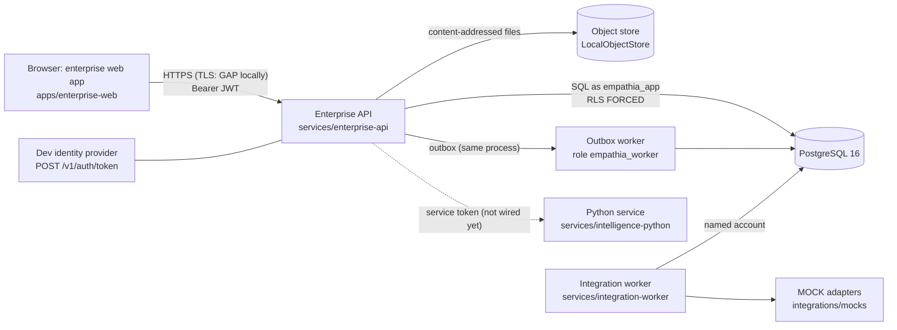

# Threat model — production starter

Method: STRIDE per component, over what the code actually does on 2026-10-26. For each threat the control is cited by file and line;
**GAP** means no control exists in the starter. This is the engineering team's own model, not an independent assessment: an external
penetration test remains **NOT VERIFIED — EXTERNAL TEST REQUIRED**.

## System and trust boundaries

Trust boundaries: browser ↔ API (untrusted client); API ↔ database (the runtime role is untrusted by the schema — RLS applies to it);
API ↔ external systems (mock today; untrusted when real); service ↔ service (Python).

## 1. Browser app (`apps/enterprise-web`)

| STRIDE | Threat | Control | Status |
|---|---|---|---|
| S | Someone uses a stolen access token | Short-lived tokens (900 s default, `services/enterprise-api/src/config.ts`); principal re-resolved from the database on every request so disabling a person or removing a membership takes effect at once (`services/enterprise-api/src/http/server.ts:55`, `domain/platform.ts` `resolvePrincipal`) | PARTIAL — no refresh-token rotation, no revocation list for still-valid tokens of active people |
| T | The UI is altered to show buttons the role lacks | The UI is never the authority: every action is checked server-side (`auth/context.ts:23-28`); proven by E2E W-09 (forged direct call → 403) | controlled |
| I | XSS reads the token | React escapes output; no `dangerouslySetInnerHTML` in `apps/enterprise-web/src` or `packages/ui/src`; CSP `script-src 'self'`, `connect-src` limited to the API (`apps/enterprise-web/server/serve.mjs:17`) | PARTIAL — the token is kept in `sessionStorage` (`apps/enterprise-web/src/api.ts:13,21`), readable by any script that does run: **GAP** for production (use OIDC with a backend-for-frontend and HttpOnly cookies) |
| I | Clickjacking | `frame-ancestors 'none'` and `X-Frame-Options: DENY` (`serve.mjs:17`, API `http/server.ts:18`) | controlled |
| S | DNS rebinding against the local web server | Host header must be 127.0.0.1/localhost, else 421 (`serve.mjs:21`) | controlled (local) |

## 2. Enterprise API (`services/enterprise-api`)

| STRIDE | Threat | Control | Status |
|---|---|---|---|
| S | Forged or tampered token; `alg=none`; algorithm confusion | Only HS256 accepted (`auth/jwt.ts:26`), constant-time signature check (`:29`), issuer/audience (`:33`), expiry with ±30 s skew (`:34`); tests in `tests/security/authz.test.mjs` | controlled for the dev IdP |
| S | Password guessing at `/v1/auth/token` | scrypt hashes, constant-time compare, same work for unknown accounts (`auth/password.ts`, `domain/platform.ts:13`); per-IP rate limit (`http/server.ts:20,59`) | PARTIAL — no lockout, no MFA (production uses the customer IdP) |
| S | Token names a role the person does not hold | Membership resolved server-side per request (`http/server.ts:55`) | controlled (test: 401) |
| T | Parameter/SQL injection | Every query uses bind parameters through the extended protocol (`db/pg.ts`); dynamic SQL fragments are fixed strings; inputs validated against the route schema, unknown query parameters refused (`http/server.ts:73-75`) | controlled; no SAST run (GAP) |
| T | Replayed or altered POST | Idempotency key bound to the request hash; a different body under the same key → 422 (`http/server.ts:78-89`) | controlled |
| R | A person denies an action, or a refused attempt leaves no trace | Every allowed state change and every authority refusal is written to `app.audit_event`, append-only (`auth/context.ts:26,33`; `database/migrations/0004_platform.sql:19`); refusals are audited in their own transaction so they survive the failed request | controlled |
| I | Cross-tenant read | Tenant set per transaction (`db/pg.ts:261`) and RLS FORCED on business tables (`database/migrations/0001_foundation.sql:22-27`); site scope applied in `domain/rooms.ts:34-45`; unseen records answer 404 | controlled (tests: cross-tenant and site-scope) |
| I | Error messages leak internals | Problem details only; unexpected errors map to `internal` with a correlation id (`http/server.ts:93-95`); logs never include tokens, passwords or bodies (`log.ts:1`) | controlled |
| D | Large bodies / request floods | Body limit (`http/server.ts:66`), per-principal/per-IP token bucket (`:59`) | PARTIAL — the bucket is in memory per process: **GAP** for multiple instances (needs an edge or shared limiter) |
| E | A role performs another role's action | Deny-by-default authority per route (`auth/context.ts:23`) plus business-rule functions (lifecycle, recording, verification) and database triggers | controlled (44 security tests) |
| E | Self-verification of a result | Rule (`packages/commissioning-engine/src/recording.ts` `verifyBlockers`) and `CHECK (verified_by <> recorded_by)` (`database/migrations/0003_commissioning_evidence.sql:133`) | controlled |
| T | Malicious evidence file (malware, polyglot) | Allow-listed media types (`domain/commissioning.ts:27,33`), file name sanitized (`:35`), served as attachment (`modules/routes.ts`) | **GAP** — no malware scanning |
| S | CSRF | Not applicable to the API as built: it authenticates with an `Authorization: Bearer` header that browsers never attach automatically, and CORS allows only configured origins (`http/server.ts:29`). It becomes relevant if cookies are introduced (BFF) — then SameSite=Strict + CSRF tokens are required | n/a today |

## 3. PostgreSQL and row-level security

| STRIDE | Threat | Control | Status |
|---|---|---|---|
| T | Evidence, results, verifications, revisions, issue history or audit rewritten | `app.refuse_change()` triggers (EM001) on all of them (`0002_core.sql:121`, `0003_commissioning_evidence.sql:88,120,144,198`, `0004_platform.sql:19`) — they apply to the owner too; verified after restore by the backup drill | controlled; a superuser can still disable triggers (operational control: no superuser use by applications) |
| E | Runtime role bypasses RLS | `empathia_app` is NOSUPERUSER NOBYPASSRLS (`scripts/db.mjs`); tested in `authz.test.mjs` | controlled |
| E | Any code running as `empathia_app` sets `app.worker = on` to read the cross-tenant outbox/notification/read-model rows | Migration 0008: the worker policies admit only the role `empathia_worker` (`database/migrations/0008_worker_role.sql`); the setting no longer opens anything; regression test `tests/security/authz.test.mjs` (KV-08) | **CONTROLLED** (was GAP) |
| I | Identity tables readable before a tenant is chosen | `tenant`, `person`, `membership` are RLS ENABLED but not FORCED; sign-in goes through SECURITY DEFINER functions (`0002_core.sql:13-15`) | accepted by design; review in the external test |
| I | Database traffic sniffed | Local cluster listens on 127.0.0.1 only (`scripts/db.mjs:54`); the client supports TLS (`db/pg.ts` `ssl`) | **GAP** — TLS not enabled locally; required in production |
| D | Connection exhaustion | Pool of 10 (`main.ts:20`) | PARTIAL — no statement timeout configured |

## 4. Object store

| STRIDE | Threat | Control | Status |
|---|---|---|---|
| T | Stored evidence altered on disk | Content-addressed by SHA-256; hash re-verified on every read (`storage/objectStore.ts:33`, `domain/commissioning.ts:50`) | detected, not prevented |
| T | Path traversal through a storage key | Key must match `^sha256/[0-9a-f]{2}/[0-9a-f]{64}$` (`objectStore.ts:22`) | controlled |
| I | Files readable by other OS users | Directories 0700, files 0600 (`objectStore.ts:20,28`) | controlled (local) |
| D/T | Deletion or ransomware of the store | — | **GAP** — needs S3 versioning/object lock and off-site copies |

## 5. Outbox worker (in the API process)

| STRIDE | Threat | Control | Status |
|---|---|---|---|
| T | Corrupt event poisons consumers | Events validated against their contract before insert (`auth/context.ts:40`) | controlled |
| D | A failing handler blocks delivery | Per-event savepoint, backoff, DEAD_LETTER after 8 attempts (`worker/outbox.ts:10,70`), admin retry restricted to `policy.configure` | controlled |
| R | Duplicate delivery | Handlers idempotent (read model recomputed; notifications unique per event/kind/role) | controlled |

## 6. Integration worker and adapters

| STRIDE | Threat | Control | Status |
|---|---|---|---|
| T | A mock's output treated as a measurement | Observations from non-VERIFIED sources must be `SYNTHETIC_MOCK` — database trigger EM004 (`0007_integration_sync.sql:26`); Assurance does not consume them | controlled |
| E | Empathia writes to a real building system | Deny-by-default `mayWrite` (`integrations/contracts/src/harmony.ts:33`): only VERIFIED + READ_WRITE + CONTROL + approved change with `baseline.approve`/`room.design.approve`; no adapter implements CONTROL | controlled (no real adapter exists) |
| S | Forged webhook | HMAC-SHA256 over timestamp and body, constant-time compare, 5-minute window (`integrations/mocks/src/mocks.ts:84-86`) | controlled in the mock; must be repeated per real adapter |
| I | Vendor credentials leak | Only credential references, never secrets, in adapter context (`integrations/contracts/src/contract.ts` `CredentialRef`); rotation check (`harmony.ts` `credentialProblems`) | PARTIAL — no secrets manager integration (GAP) |
| S | Worker identity abuse | Worker acts as a named account authorized like a person and audited (`services/integration-worker/main.mjs`) | PARTIAL — development uses the seeded security administrator; production needs a dedicated non-human account |

## 7. Python service (`services/intelligence-python`)

| STRIDE | Threat | Control | Status |
|---|---|---|---|
| S | Unauthenticated use | Required service token, 503 when unset, 401 when wrong (`app/main.py:28,76-78`) | controlled (static shared token: rotate via secrets manager — GAP) |
| T | Malformed input | pydantic models with `extra: forbid`, bounds, 500-row and 256 KiB limits | controlled |
| E | A score used as a decision | Every response labelled `RESEARCH_PROTOTYPE_SYNTHETIC_DATA` with "never records, skips, passes or waives a test"; no caller in the API | controlled |
| T | Model file tampering | JSON model only, no pickle loading for inference; feature list checked (`ml/inference/predict.py`) | controlled |

## 8. Development identity provider

| STRIDE | Threat | Control | Status |
|---|---|---|---|
| S | Dev sign-in reachable in production | `AUTH_MODE=dev` refused when `NODE_ENV=production`; `JWT_SECRET` required there; synthetic seed refused there (`config.ts:35,38,43`; `db/seed.ts`) | controlled |
| S | Shared documented password | The development password is documented and synthetic | accepted for development only |
| I | HS256 secret compromise lets anyone mint tokens | Secret ≥ 32 bytes, file mode 0600 (`config.ts:40-43`) | **GAP** for production — replace with OIDC RS256/JWKS (asymmetric; the API never holds a signing key) |

## Top risks to close before production

1. OIDC + BFF with HttpOnly cookies (removes the sessionStorage token and the symmetric signing key).
2. Separate database role for the workers; statement timeouts; TLS to the database.
3. Object storage with versioning/object lock and malware scanning of evidence.
4. Shared rate limiting at the edge; metrics and alerting.
5. External penetration test and dependency/SAST scanning in CI.
