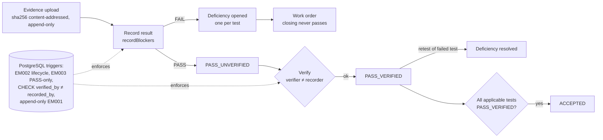

# ID-01 — Evidence-gated commissioning results with enforced verification separation

**Attorney-review material. Not a patent application, not a patent grant, no novelty or patentability opinion.**

## Technical problem
In audio-visual and building-systems commissioning, a test is often marked "passed" by the same technician who ran it, from a checklist, sometimes before the equipment is installed, with no stored evidence. Downstream systems then treat "pass" as proven. The record cannot distinguish an asserted pass from an independently confirmed one, and nothing stops results being recorded against a design rather than an installed room.

## Proposed solution
A result model with no bare "PASS" label. A recorded PASS is stored as **PASS_UNVERIFIED** and becomes **PASS_VERIFIED** only when a *different person* holding verification authority confirms it. Recording is refused unless (a) the room is in the COMMISSIONING lifecycle state, (b) the test is applicable to that room's current plan, (c) the recorder is one of the test's responsible roles, (d) the evidence kind is one the test accepts, (e) an evidence object exists and (f) instrument-measured tests name the instrument. A FAIL opens exactly one commissioning deficiency per test; closing a field work order never resolves it — only a verified PASS retest does. Acceptance of the room requires every applicable test to be PASS_VERIFIED. The same rules are enforced twice: in the application and again by database constraints and triggers, so a direct database write cannot bypass them.

## Architecture

## Implementation details
- Recording rules: `packages/commissioning-engine/src/recording.ts:15` (`recordBlockers`), verification rule `:40` (`verifyBlockers`).
- Result labels and acceptance: `packages/commissioning-engine/src/results.ts:9` (`resultLabel`), `:15` (`resultCounts`), `:40` (`acceptanceBlockers`); lifecycle gate `packages/commissioning-engine/src/lifecycle.ts:34`.
- Server application: `services/enterprise-api/src/domain/commissioning.ts` (`recordResult`, `openCxDeficiency`, `verifyResult`, `closeWorkOrder`).
- Database enforcement: `database/migrations/0003_commissioning_evidence.sql` — `app.test_result` lifecycle trigger (ERRCODE EM002), `app.verification` with `CONSTRAINT verification_is_independent CHECK (verified_by <> recorded_by)` and `app.verify_only_pass()` (EM003), append-only triggers (EM001), and the `app.current_result` view that derives the label.
- Demonstrator origin: `src/v25-60-room.js:500` (`v25RoomResultLabel`), `:510` (`v25RoomRecord`), `:527` (`v25RoomVerify`); evidence-ref PASS rule introduced in the 2.5.1 commissioning framework (`src/v25-096-cxuni.js:161` `v25CxStatus`).

## Algorithms
Label = NOT_TESTED if no result; for state PASS → PASS_VERIFIED iff a verification exists by a person ≠ recorder, else PASS_UNVERIFIED; other states map to themselves. Room acceptance blockers = applicable rows whose label ≠ PASS_VERIFIED, plus open issues. Constant-time per test; linear in applicable tests per room.

## Distinguishing features (factual, not a novelty claim)
Absence of any bare PASS label anywhere (API, events, read models — the event contract rejects `resultLabel: PASS`); independence enforced at the database level, not only in the UI; lifecycle-gated recording ("nothing passes from a design"); work-order closure explicitly decoupled from test status.

## Development timeline (git)
- 2026-10-23 `5036d12` (demonstrator): "Release 2.5.1 — Universal Intelligent Commissioning Framework … evidence-ref PASS rule".
- 2026-10-24 `f9ae2b4`: Build a Room engine with result recording per room.
- 2026-10-26 `b8986d1` (demonstrator, `founder/2.5.4`): machine-readable result and event labels (audit finding R3-2), so PASS_UNVERIFIED is distinguishable everywhere.
- 2026-10-26 monorepo `03d9410` (server and database enforcement) and `ad4ed25` (integration tests `tests/integration/api.test.mjs` slices 6–7; negative tests `tests/security/authz.test.mjs`).

## Supporting code and tests
`tests/integration/api.test.mjs` (slices 6–7), `tests/security/authz.test.mjs` (EM002, EM003, independence CHECK), `packages/commissioning-engine/test/parity.test.ts`.

## Prior-art questions (open)
1. Commissioning-management and quality-management products with "verified by" or two-person sign-off fields — do any make the unverified state a distinct, mandatory label and enforce verifier ≠ recorder in storage?
2. Laboratory information systems and clinical/GxP electronic-record practice (second-person review) — how close is the method?
3. Is lifecycle-gating of result capture (refusing results before installation) known in construction-commissioning tools?

## Potential applications
AV and building-systems commissioning; any field-test regime needing auditable separation of execution and verification (fire/life-safety tests, network acceptance, equipment validation).
