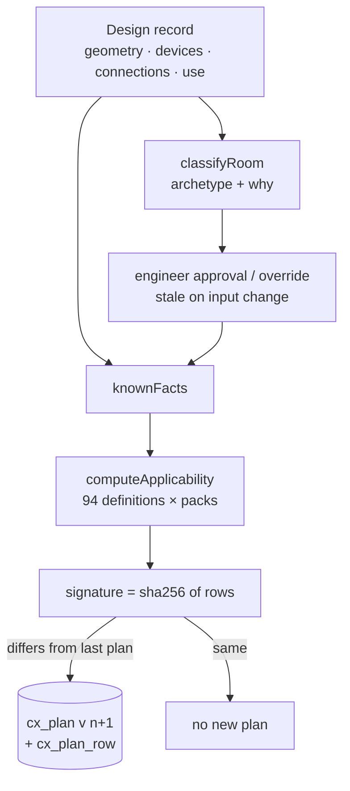

# ID-02 — Design-driven commissioning applicability with signature-based plan recompilation

**Attorney-review material. Not a patent application, not a patent grant, no novelty or patentability opinion.**

## Technical problem
A commissioning plan is usually a static checklist chosen by room type. When the design changes (a device added, a model swapped, the room re-classified), nobody knows which tests now apply, which no longer apply, and which recorded results are still relevant. Plans drift from the design, or are regenerated wholesale and lose history.

## Proposed solution
Derive the plan from the design every time the design changes: (1) classify the room from its geometry, occupancy, intended use and device families (with an explainable "why" list, and an engineer approval or override with a reason that becomes stale when inputs change); (2) evaluate each of 94 test definitions against facts known from the design (device families, packs, project type, risk tier, archetype), producing applicable / not applicable with reasons and the evidence kinds and responsible roles per test; (3) compute a signature over (test id, applicable, status, result) for all rows; (4) store a new immutable plan version **only when the signature changes**, keeping every earlier version and the trigger that caused it.

## Architecture

## Implementation details
- Classification: `packages/commissioning-engine/src/classify.ts:44` (`classifyRoom`), `:25` (`recommendArch`), `:123` (`effectiveArchetype`).
- Applicability: `packages/commissioning-engine/src/applicability.ts:25` (`requiredTests`), `:52` (`packApplies`), `:71` (`knownFacts`), `:94` (`computeApplicability`); entry `packages/commissioning-engine/src/index.ts:39` (`analyzeRoom`).
- Signature and versioned plans: `services/enterprise-api/src/domain/rooms.ts:124–129` (signature, compare with last plan, insert only on change).
- Rule data: `packages/domain-data/data/V25_TESTS.json`, `V25_CX_CATALOGUE.json`, `V25_CX_PACKS.json`, `V25_ROOM_REQUIRED.json`, `ARCHETYPES.json` (extracted unchanged from the demonstrator; `PROVENANCE.json`).
- Demonstrator origin: `src/v25-60-room.js:279` (`v25RoomClassifyCompute`), `:385` (`v25RoomApplicabilityCompute`), `:403` (`v25RoomApplicabilityCompile`); pack evaluation `src/v25-096-cxuni.js:131` (`v25CxApplies`).

## Algorithms
Classification: rule cascade over occupancy, area band, device-family count and intended use → archetype with reasons. Applicability: for each definition, required-test rules by archetype/project type plus pack rules (any/all matches on families, risk, tier); output row {applicable, status, why[], personas[], evidence[], instrument, devices[]}. Complexity O(T × P) per analysis (T = 94 tests, P = packs). Golden parity: 92 cases (`packages/domain-data/golden/room-engine-golden.json`) reproduce the demonstrator exactly.

## Distinguishing features (factual)
Explainable classification with an approval that turns stale; per-test reasons; plan versioning keyed by a content signature so unchanged analyses do not create versions; the plan carries engine and rule versions.

## Development timeline (git)
2026-10-23 `5036d12` (universal framework, 2.5.1); 2026-10-24 `f9ae2b4` (94-definition applicability with re-evaluation log, Build a Room); 2026-10-26 monorepo port (`03d9410`) with parity tests.

## Prior-art questions (open)
1. Rules-based test-plan generation in commissioning software (e.g. checklists generated from equipment lists in construction QA tools).
2. Content-hash-gated versioning of derived plans (common in build systems/caches) applied to commissioning — how close?
3. Explainable room-type classification in workplace/AV design tools.

## Potential applications
Any system whose verification obligations depend on a changing design: AV, security, network, MEP commissioning; regulatory test planning.
