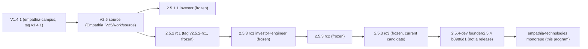

# Release lineage

Frozen-release integrity re-checked 2026-10-26T13:45:47+00:00 with `scripts/verify/verify-frozen.py`: **PASS** (every file listed in each package's SHA256SUMS re-hashed; immutable attribute present; every archive matches its recorded sha256). Raw result: `FROZEN_CHECK_VAULT.json`.

**Distribution:** no package below is authorized for external distribution. The independent page-API security assessment remains NOT VERIFIED — EXTERNAL TEST REQUIRED, and owner conditions are open. The 2.5.x "independent audits" referenced in tag messages were performed by a separate AI reviewer, not an independent human or third-party auditor.

| Version | Edition | Package | Tag → commit | Files | Mismatches | Offline / private edition sha256 | State |
|---|---|---|---|---:|---:|---|---|
| 2.5.1.1 | investor | `Empathia_V25/Empathia_Investor_Release_2511` | — → `4b30315` | 495 | 0 | `b2e82e79dbe977e5fbb2999e45db33159f9a547737936d27777d9809c29609a2` | frozen; security patch line (branch patch/2.5.1.1, worktree source-251p) |
| 2.5.2 rc1 | investor | `Empathia_V25/Empathia_Investor_Release_252` | v2.5.2-rc1 → `09db55093c` | 519 | 0 | `86bbf66af2f2e166aa965224511cc8fc5582a6afd189886510a28a9be500717b` | frozen 2026-10-25 |
| 2.5.3 rc1 | investor | `Empathia_V25/Empathia_Investor_Release_253` | v2.5.3-rc1 → `7a8ca84d06` | 563 | 0 | `b90871da39cc25c5858eb7209d6a641719ddfc848c8ba921ec2702a33d4bb240` | frozen; superseded by rc2/rc3 |
| 2.5.3 rc1 | engineer | `Empathia_V25/Empathia_Engineer_Edition_253` | v2.5.3-rc1 → `7a8ca84d06` | 65 | 0 | `92882a86f7e86870625347cd859dd39fd2351ba3779314f57375e2882b07432b` | frozen; superseded |
| 2.5.3 rc2 | investor | `Empathia_V25/Empathia_Investor_Release_253_rc2` | v2.5.3-rc2 → `0cb8a0f1d0` | 562 | 0 | `96f539d9061388bd3660639a71212199e01d1a6bf8c566555d4be374e7d88e7b` | frozen; superseded by rc3 |
| 2.5.3 rc2 | engineer | `Empathia_V25/Empathia_Engineer_Edition_253_rc2` | v2.5.3-rc2 → `0cb8a0f1d0` | 65 | 0 | `793865d242f2b9ae8da9d94740455bfede7c7ee4e9916587c9f4e9a3dc0e12c8` | frozen; superseded |
| 2.5.3 rc3 | investor | `Empathia_V25/Empathia_Investor_Release_253_rc3` | v2.5.3-rc3 → `cf86866ac8` | 562 | 0 | `ecbde0bba17eafc9e5bcf98b57d15fbbb2378bac66d017c7a402194e78307756` | frozen; current candidate |
| 2.5.3 rc3 | engineer | `Empathia_V25/Empathia_Engineer_Edition_253_rc3` | v2.5.3-rc3 → `cf86866ac8` | 65 | 0 | `604cc7486e4a63a214c6ea471d8dc41fb826060483f24ee8dbd88df8aecb56f7` | frozen; current engineer candidate |
| 2.5.4-dev | founder (development build, not a release) | `apps/founder-studio/dist/demonstrators/founder/Empathia-Founder-Edition.html (built from source)` | — → `b8986d1` | — | — | `ecdf64be4de7cda5096c8dd7902814e26a7b1fe5d693799f9d489fbbddcbe1ee` | development line for the founder program; not a release candidate |

## Archives

| Archive | sha256 | Matches record |
|---|---|---|
| `Empathia_Engineer_Edition_253-rc1-7a8ca84.tar` | `792aa890fffe37efe4ab6b346870edb1757edb84e38f92d445ab22138d036e10` | yes |
| `Empathia_Engineer_Edition_253_rc2-0cb8a0f.tar` | `4bc7ce575f38b3aae33e8804a789f9496c1c468226d7a91501c14b781e6c4193` | yes |
| `Empathia_Engineer_Edition_253_rc3-cf86866.tar` | `1f88b962890308b74663046479da77698cebd8ea00f6de91e01bed17f9462b30` | yes |
| `Empathia_Investor_Release_252-rc1-09db550.tar` | `d2c80b3214ae7000b7d70fabb4d1dd5a3d604a5622825450c14d574181a28975` | yes |
| `Empathia_Investor_Release_253-rc1-7a8ca84.tar` | `35ed6ca7eeedf492746aefa093096712cc4f10bd10942fc872b4d2201a612634` | yes |
| `Empathia_Investor_Release_253_rc2-0cb8a0f.tar` | `6c4f66737c19c4032f3491f5da06f0d5f891d0db6bcaaad0c44a42be726adaf0` | yes |
| `Empathia_Investor_Release_253_rc3-cf86866.tar` | `f332b436bf9b9190169130ec2d8df5b5e8afe805bed5a08086cfc0b8a4ddc4e2` | yes |

The 2.5.1.1 package has no deterministic tar archive in `work/frozen`; its integrity rests on its SHA256SUMS (495 entries, 0 mismatches) and the immutable attribute.

## Lineage

Historical V1.2–V1.4.1 copies: 58 records in the access-controlled historical-release audit (by id and hash in `RELEASE_LINEAGE.json`); see that audit for their restrictions.
